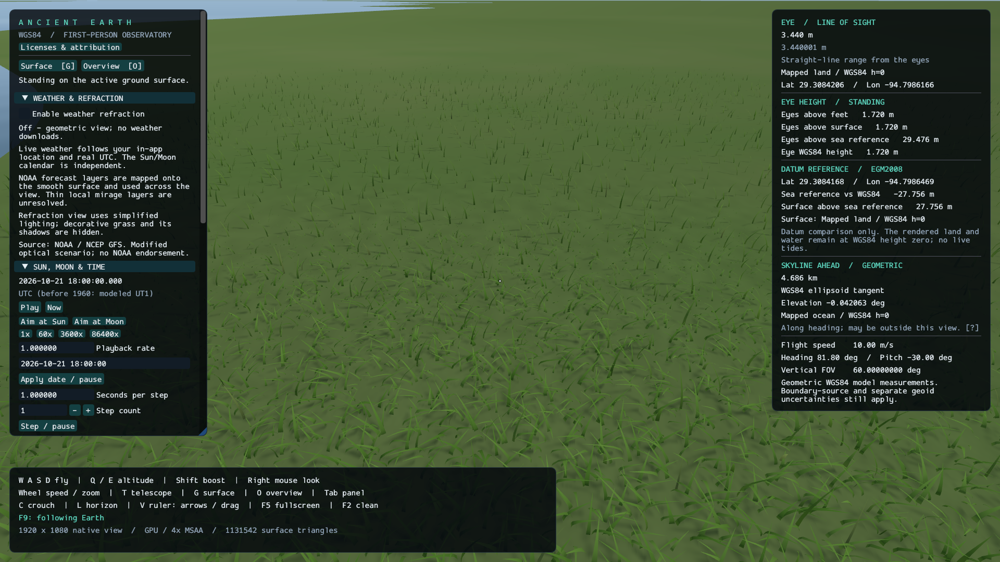
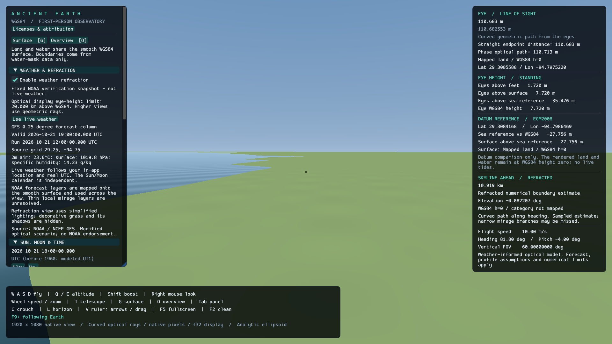
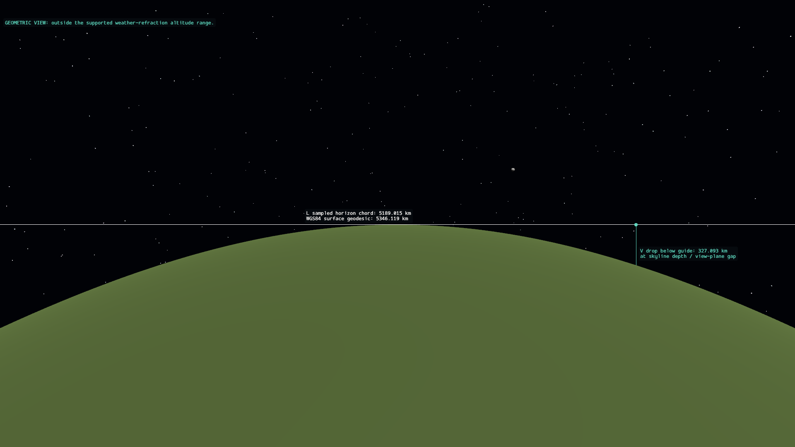

# Ancient Earth

A native first-person Earth explorer built with **Rust, Bevy 0.20.0 and Dear ImGui** through the `dear-imgui-rs` / `dear-imgui-bevy` 0.21.0 integration. Land and water default to a smooth WGS84 ellipsoid. Optional Copernicus downloads enable source-derived terrain; a toggle restores the smooth surface while preserving downloaded files. Regional and downloaded water masks supply detailed categories; Natural Earth supplies coarse global land/ocean context. Earth photographic imagery remains removed. The app includes procedural Earth materials, nearby grass, shadows and a time-controlled Sun and Moon. The Moon uses NASA LRO-based maps and relief shading, with documented finite accuracy. GPS navigation remains; city catalogs, pins and named location shortcuts have been removed. Positions, camera rays, flight and measurements use a separately tested double-precision math library.



<details>
<summary>More native screenshots: weather controls and clean-view measurement guides</summary>

Weather refraction enabled with the explicitly labeled fixed NOAA verification snapshot:



F2 clean view with L/V guides; this high-altitude view explicitly uses geometric fallback:



These unmodified 1920×1080 captures were taken from the running app on 2026-10-21. Source credits and redistribution terms are recorded in [NOTICE.md](NOTICE.md) and [the asset inventory](licenses/assets.json).

</details>

- [Stack](#stack)
- [Getting started and controls](#getting-started)
- [Earth model, sources and calculations](#earth-model-sources-and-calculations)
- [Accuracy and scope](#accuracy-and-scope)
- [Further documentation](#documentation)
- [Validation commands](#validation)

## Stack

Versions below describe the project's manifests and lockfile. The Dear ImGui version numbers refer to the Rust integration crates.

| Component | Version / choice | Role |
| --- | --- | --- |
| Language and toolchain | Rust 1.97.1, edition 2024 | Native application, with `rustfmt` and Clippy pinned by [rust-toolchain.toml](rust-toolchain.toml). |
| Engine | Bevy 0.20.0 | Application scheduling, window, input, GPU 3D rendering and screenshots. |
| GUI | `dear-imgui-rs` 0.21.0 and `dear-imgui-bevy` 0.21.0 | Dear ImGui coordinate entry, settings and measurement overlays. |
| Graphics backend | `wgpu` 30.0.1, through Bevy PBR | Native-resolution terrain meshes, antialiasing, lighting and shadows using the platform graphics backend. |
| Scientific geometry | Local [`earth-math`](crates/earth-math), GeographicLib Rust 0.2.7 | Authoritative `f64` geodesy, observer state, intersections, projections and measurements; GeographicLib supplies ellipsoidal geodesic distances. |
| Geoid decompression | `flate2` 1.1.10 | Loads the losslessly compressed offline EGM2008 grid. |
| Optional weather | NOAA / NCEP GFS through NOMADS | Current forecast profiles for the in-app observer location; explicit enable/disable toggle and provider timestamps. |
| Weather decoding and transport | `grib` 0.18.2, `ureq` 3.4.2 with Rustls, `ring` 0.17.14 | Pure-Rust GRIB decoding, bounded HTTPS downloads and SHA-256 cache integrity. |
| Elevation decoding | `tiff` 0.11.3, DEFLATE only | Native GeoTIFF decoding; registration, datum conversion and bounded source-post preprocessing in `earth-math`. |
| Data serialization | `serde_json` 1.0.154 | Writes frame-capture diagnostics. Serde remains a transitive dependency; the catalog's direct dependency was removed. |
| Earth geometry standard | NGA WGS84 reference ellipsoid | Defines the dimensions and coordinate model explained below. |
| Surface | NGA WGS84 ellipsoid | Smooth reference by default; manual Copernicus GLO-30 downloads add optional source elevations. |
| Water classification | Copernicus Water Body Masks; Natural Earth land v5.1.1 | Reconstructed regional borders, downloaded native categories and coarse global polygon-derived context; no imagery or height inference. See [water methods and limits](docs/science/water.md). |
| Earth surface appearance | Original procedural materials and grass | No Earth photographic map layer. Materials are illustrative, not a surveyed land-cover classification. |
| Moon appearance | NASA SVS LROC color and LOLA-derived shading normals | Real mapped lunar features; processed display colors and a spherical geometric surface. See [lunar rendering](docs/science/lunar-rendering.md) and [source rights](licenses/NASA-SVS-lunar.md). |
| Astronomy | Bundled JPL DE440s, IERS tables through Astropy, ERFA-derived orientation | Offline Sun/Moon positions and Earth rotation; sources, date coverage and uncertainty are documented in [astronomy](docs/science/astronomy.md). |
| Optional data preparation and verification | Python 3, Rasterio, PyProj, SpiceyPy and PyERFA | Source-data preparation and independent scientific checks. These tools are not needed to run the app. |
| Validation | Rust tests, Clippy, `rustfmt`, GitHub Actions | Checks scientific calculations, GPS navigation and desktop integration. |

Direct dependency requirements live in [Cargo.toml](Cargo.toml); [Cargo.lock](Cargo.lock) records the resolved versions, including transitive dependencies. Use `--locked` for reproducible dependency selection.

The GPU draws at the window's native resolution; the dedicated math library remains the authority for positions, collision and measurements. The GUI uses Dear ImGui throughout. Surface and astronomy data are embedded; optional live weather connects directly to NOAA and manual elevation downloads use the reviewed Copernicus GLO-30 Public distribution. There is no application server or database. See [architecture](docs/development/architecture.md), [rendering mathematics](docs/science/rendering.md) and [data attribution](NOTICE.md). Earlier elevation/photographic assets and screenshots remain as historical source material with their original notices; the current renderer does not load them.

## Getting started

```powershell
cargo run --release --locked
```

Rust 1.97.1, a desktop graphics driver, and a C++ toolchain are required. On Windows, install Visual Studio Build Tools with **Desktop development with C++** and CMake. The first build downloads dependencies. The base app works offline; enabling live weather requires NOAA access.

Use Vulkan for weather refraction on Windows. DirectX 12 currently keeps the view and measurements geometric because native tests exposed device-loss failures in its optical shader. If Windows reports missing Vulkan SDK layer JSON files, see [startup diagnostics and backend selection](docs/user-guide.md#windows-startup-diagnostics).

The **Preparing graphics** screen covers initial shader and scene preparation. Pipeline compilation runs in the background; the screen offers **Close app**, and flight becomes available when preparation finishes. A first switch to another optical mode can show a preparation status. See [display behavior](docs/user-guide.md#display) for the remaining driver and upload limits.

The app opens standing at **29.305549, -94.767015**, facing east. Press **O** (or launch with `--overview`) for the globe overview. **Land & Water → Show mapped land / water** toggles the land/water classification layer. **Coast view** opens a view derived from a loaded land/water boundary. The window starts at **1920 × 1080**; **F5** switches to fullscreen at the monitor's resolution and back to the previous window size.

**Sun, Moon & Time** starts at the current system date and time. Use **Pause / Play**, **Now**, playback rate presets, an editable calendar date, and a signed step count with seconds per step. Calendar entry is UTC except before 1960, when the historical time model is identified in the panel. Ephemeris coverage is finite; the panel displays the applicable Earth-rotation quality. See [astronomy](docs/science/astronomy.md) for the supported interval and scientific limits.

Eclipse geometry and shadows remain active at your coordinates and selected date. Named location demonstrations have been removed. See the [eclipse model and limits](docs/science/eclipses.md).

Start in the generic coast inspection view:

```powershell
$env:WGPU_BACKEND = "vulkan"
cargo run --locked -- --coast
```

Add `--ground` to place your feet on the smooth surface. Global land/ocean context is cartographic; downloaded native masks and reconstructed regional borders provide finer categories where available. For a repeatable daylight view:

```powershell
.\target\debug\ancient-earth.exe --coast --datetime "2026-10-21 18:00:00" --paused
```

Calendar arguments use UTC. With elevations off, land and water remain at WGS84 height zero; the EGM2008 readout is a separate datum comparison. There are no live tides. Optional weather-informed refraction uses a validated NOAA forecast profile and keeps its assumptions and timestamps visible. [Water documentation](docs/science/water.md) explains the data and boundary limits.

Open **Weather & Refraction → Enable weather refraction** to enable or disable it. It starts disabled. `--weather` starts with live weather enabled; `--weather-reference` selects the explicitly labeled fixed verification snapshot instead. The live mode uses real UTC even if you change the astronomy calendar. Decorative grass and its shadows are hidden while the optical display is active; switching the toggle off restores the existing PBR view. See [weather controls and limitations](docs/user-guide.md#weather-and-refraction).

All sections in the left navigation panel start collapsed. Click their headings to expand them; expanded states are retained for the current session and reset on restart.

**Custom weather**, beneath **Refresh weather**, expands an editor initialized from your location's loaded weather. Expand individual layers to edit them and choose **Apply custom weather**; **Use live weather** returns to automatic updates. Custom scenarios are labeled and last for the current session. See [weather controls](docs/user-guide.md#weather-and-refraction).

The current optical display is limited to eye heights at or below 20 km above WGS84. Higher views retain weather data and explicitly use geometric rendering and measurements; this avoids claiming unresolved orbital ray results. See [display precision and limits](docs/science/rendering.md).

Refraction is an optional scientific display with substantial performance cost and finite forecast and numerical accuracy. The terrain/marker scene passed native 1080p Vulkan presentation on the RX 7900 XTX, but its debug baseline with application-reported focus delivered only **2.31 FPS**. Exact-input reuse now avoids solving the same primary rays again while the view and physical inputs remain unchanged. A stationary diagnostic recorded 32.51 FPS, but OS foreground conditions were not consistently verified, so this is not a controlled focused comparison. Changing the view still requires new rays: a completed, explicitly unfocused flight diagnostic averaged 7.40 FPS and does **not** establish smooth flight. These application intervals are not GPU timings or guarantees for other views. See the [current evidence and limitations](docs/science/verification.md) and [test configurations](docs/development/validation.md).

For GPS entry, **Go to ground at coordinates** places your feet on the surface; **Go to exact coordinates** uses the supplied ellipsoidal height and rejects positions below the surface. **G** brings your feet to the ground and restores an upright, level view while preserving your heading; **O** returns to an overview.

**Observer & Display → Frame limit** defaults to 60 FPS, with 30, 120 and Unlimited also available. Background windows are limited to 15 FPS and minimized windows to 5 FPS; elapsed-time simulation continues. Use `--frame-limit 30`, `60`, `120` or `unlimited` at launch. See [rendering and pacing](docs/science/rendering.md) for the implementation and measurement limits.

### Controls

| Control | Action |
| --- | --- |
| W / A / S / D | Fly forward / left / back / right while mouse look is captured |
| Q / E | Roll your body left / right while mouse look is captured and horizon lock is inactive |
| Space / Shift | Move up / down relative to your body's current orientation |
| Left-click the scene | Capture the mouse for continuous look and flight |
| Ctrl | Precision flight |
| Mouse wheel | Change flight speed; change zoom when using the telescope |
| T | Toggle telescope |
| R | Exit telescope and restore the default normal view without moving |
| 1 / numpad 1 | Configure a marker row; confirm Spawn markers before anything is placed |
| M, then left-click twice | Enable tape and select A/B at the center dot; M hides/restores it |
| Hold C | Crouch; release to stand |
| L | Toggle the one-pixel guide at the highest detected visible skyline |
| V, then Left / Right arrows or drag | Show and move the vertical guide while L is enabled |
| F9 | Toggle following Earth's rotation; use Play or time steps to see Earth turn beneath you |
| F5 | Toggle fullscreen and restore the previous window size |
| F2 | Hide or restore panels and center dot; retain upper-right eye Height and independently usable L/V |
| G / O | Land upright and level / overview |
| Tab | Show or hide the navigation panel |
| I | Open or close Earth, Sun and Moon mathematical information, also in F2 |
| Escape | Release mouse capture |

Each main panel has a compact arrow attached to its inner edge. Click to collapse it; the arrow remains at the screen edge to reopen it. Panel fonts use a smaller default size. F2 hides the panels and arrows while preserving their individual states. **Observer & Display → Show tooltips** controls hover help. The **I** information window has Earth, Sun and Moon tabs with dimensions, paired metric/Imperial units, live simulation measurements, scientific definitions and source links. See [astronomy information](docs/science/astronomy-info.md).

The first three top icons are **Earth, Moon and Sun**, in that order. **Click** to aim; **double-click** to track. Double-click the highlighted target again to stop. Manual mouse look, unlocked Q/E roll or an explicit navigation action releases tracking. Flight and time changes retain tracking; aiming preserves your position and zoom. Hidden bodies remain hidden, and atmospheric bending can shift their visible image from the aiming direction. **Orbits & Axis Guides** provides separate Earth and Moon axis/tilt guides. The Moon guide also works in telescope view; straight-ray annotations are hidden during active refraction.

The fourth top icon toggles **Horizon lock**, also available in **Observer & Display**. It defaults to on: prevent sideways tilt near Earth while retaining free up/down looking. Q/E roll is ignored while the lock is active. It automatically releases in space and re-levels on return. Turn it off for unrestricted roll, or launch with `--no-horizon-lock`. Earth curvature and horizon dip remain visible. See [the leveling definition and control threshold](docs/science/horizon-lock.md).

Fly continuously from the ground into space with the same camera and controls. Orbital-path and Earth-axis guides become available automatically at suitable space-view distances; **B is no longer required or bound to a mode**. **Automatic flight speed** adapts navigation speed to nearby modeled surfaces, while the wheel adjusts base speed and Ctrl slows for precision. Space and Shift follow your body's up/down direction, including when tilted or inverted; Shift no longer boosts speed. Escape releases the cursor and stops keyboard flight. **Aim at Earth**, Sun/Moon aiming, **Overview [O]** and **Fit whole orbit** remain optional navigation conveniences. Earth photographic imagery remains removed. See [continuous-flight mathematics and limits](docs/science/orbital-overview.md).

The GUI provides coordinate entry, metric/imperial units, configurable eye height, normal rectilinear and equidistant fisheye views, telescope zoom, and render quality.

The center dot measures **from the observer's eyes to the modeled target**: a straight distance in geometric mode, or a curved geometric path with optional phase optical length in atmospheric mode. Six-foot stature is exactly 1.8288 m; eye height defaults to an explicit, adjustable 1.72 m assumption.

## Tape and markers

**1** opens a placement menu with default **0.5-mile spacing, 40-mile reach, and 100-foot left offset** from your horizontal heading. Each marker is a grounded **10 × 10 × 100-foot** rectangular prism with red/green one-foot bands, red first. The row follows Earth. Hovering a visible marker reports the portion of its vertical centerline hidden by the active Earth surface; terrain results state their sampling limit. **Tape & Markers** provides visibility and clearing controls.

Black signs above the markers display white numbers starting at **0001**. They turn toward the observer while staying upright along each marker's local vertical. Signs are annotations and do not change the measured marker height.

**M** enables the tape: click the scene once to capture mouse look, then aim the dot and left-click for A, then B. The display distinguishes straight-line endpoint distance from the WGS84 surface geodesic. Endpoints can lie on ground or markers. Eligible refraction now traces active terrain and marker prisms, and survey picks use the same curved paths. Changing the physical surface clears the old survey. See [controls](docs/user-guide.md#tape-measure-and-marker-rows) and [the independently reviewed geometry](docs/science/survey.md).

## Optional elevation downloads

Open **Topography Download**. The default and maximum radius is **100 miles (160.9344 km)** around your current position; Imperial is the default. Larger requests are rejected before downloading. **Estimate size** checks provider sizes and cached files. **Download + enable** saves and activates elevations and matching water masks, with progress, approximate storage, water-mask counts and retained mesh resolution shown in the panel. **Elevations (off = smooth Earth)** restores smooth WGS84 while retaining downloaded categories and files. **Load last saved area (offline)** restores the last completed area after restarting.

Older downloads that show a small rectangular coastal map need one **Download + enable** operation to add the water masks; verified elevation files are reused. Downloaded mask coverage follows the selected source tiles. Outside detailed masks, the bundled Natural Earth land polygons provide explicitly coarse global context. No photographic imagery is used.

The source is the [Copernicus GLO-30 Public DSM, AWS 2021 distribution](https://registry.opendata.aws/copernicus-dem/). Whole source tiles and seam-support neighbors extend beyond the radius. Some ocean/restricted regions have no source data. Original GeoTIFFs remain cached with product metadata, hashes, credits, a local `licenses/assets.json` and the reviewed license. Unknown/revised license terms are rejected. Runtime meshes are bounded and may retain coarser spacing than the source. See [import mathematics and limits](docs/science/topography.md).

Eligible terrain-enabled views use the same weather profile and curved-ray scene for rendering, range and L/V; unsupported or unresolved cases remain explicit. Earth photographic imagery remains removed. Height readouts keep feet with miles in parentheses, or metres with kilometres in parentheses. Turning **L** on enables **V** by default; V then hides/restores the vertical ruler. Both work in F2 clean view.

In the right pane, **Eye Height** and **Datum Reference** use whole feet and inches in Imperial mode, retaining miles in parentheses. This rounds only the display to the nearest inch; the underlying measurements are unchanged.

## Earth model, sources and calculations

AncientEarth starts with a **smooth WGS84 ellipsoid**: land, ocean, lakes and rivers have ellipsoidal height `h=0`. Optional manually downloaded Copernicus elevations replace covered areas with a canonical source-post triangle mesh; disabling Elevations restores the smooth surface and keeps the cache. Regional water masks supply independent category borders. Authoritative positions, collision and Earth distances use the selected `f64` surface in [earth-math](crates/earth-math/src/lib.rs). Angles inside trigonometric functions are radians; the GUI accepts degrees.

### Where Earth's dimensions come from

[NGA's WGS84 definition](https://earth-info.nga.mil/index.php?action=wgs84&dir=wgs84) specifies the two geometric constants used here:

| Quantity | Value | Status |
|---|---:|---|
| Equatorial semi-axis `a` | 6,378,137 m | Exact defining decimal |
| Inverse flattening `1/f` | 298.257223563 | Exact defining decimal |
| Flattening `f` | ≈ 0.003352810664747481 | Derived |
| Polar semi-axis `b` | ≈ 6,356,752.3142451795 m | Derived |
| First eccentricity squared `e²` | ≈ 0.006694379990141317 | Derived |

```text
f = 1 / 298.257223563
b = a(1 − f)
e² = f(2 − f)
ellipsoid: X²/a² + Y²/a² + Z²/b² = 1
```

The approximate values above were independently calculated with 70-digit decimal arithmetic. The application evaluates the same expressions in binary `f64`, which rounds most decimal constants and derived results. NGA's nominal gravitational and rotation parameters are not the orbit/rotation solver: positions come from JPL DE440s, and Earth orientation uses IAU/IERS time-dependent rotations as described below. Flight itself remains a navigation tool without gravity.

### GPS coordinates and Cartesian positions

Latitude `φ` is **geodetic**: the angle of the ellipsoid normal, rather than the radius from Earth's center. Longitude `λ` increases eastward. Height `h` follows that normal and means height above the ellipsoid, **not mean sea level or terrain elevation**.

Earth-centered, Earth-fixed coordinates (ECEF) use X through `(0°, 0°)`, Y through `(0°, 90°E)`, and Z through the north pole. The forward equations follow the geographic/geocentric conversion in [IOGP/EPSG Guidance Note 7-2, section 4.1.1](https://www.iogp.org/wp-content/uploads/2019/09/373-07-02.pdf):

```text
N = a / sqrt(1 − e² sin²φ)
X = (N + h) cosφ cosλ
Y = (N + h) cosφ sinλ
Z = [N(1 − e²) + h] sinφ
```

Our inverse uses a fixed-point rearrangement of those equations:

```text
r = hypot(X, Y)
λ = atan2(Y, X)                         # use 0 when r = 0
φ₀ = atan2(Z, r(1 − e²))
Nₖ = a / sqrt(1 − e² sin²φₖ)
φₖ₊₁ = atan2(Z + e²Nₖ sinφₖ, r)
h = r cosφ + Z sinφ − a sqrt(1 − e² sin²φ)
```

Iteration stops when the latitude change is below `2ε`, or after 20 iterations, where `ε = 2⁻⁵²` is `f64::EPSILON`. The height formula avoids dividing by small sines or cosines near the equator or poles.

The conversion API supports heights from −10,000 m through four exact astronomical units (598,391,482,800 m) and rejects unsupported deep-interior positions. Input validation is strict; inverse Cartesian conversion accepts only a numerical endpoint allowance of `max(0.00001 m, 16 ε |P|)`, about 2.13 mm at the largest range. [Continuous flight](docs/science/continuous-flight.md) uses this same observer and lens from ground to space; its adaptive inspection speeds are not physical spacecraft velocities. Exact navigation requires feet at or above the active surface and room below the upper limit for the eyes. Smooth mode rejects negative feet heights; optional imported terrain can support negative ellipsoidal heights wherever the actual source surface permits them. Invalid destinations leave the observer unchanged. A separate ground action explicitly snaps to the surface. Longitude and compass orientation at an exact pole are conventions.

### Land/water boundaries without elevation data

The category model combines three sources in priority order: the four reconstructed regional borders, downloaded native **Copernicus Water Body Masks**, then coarse global context from **Natural Earth land v5.1.1**. WBM codes are 0 land, 1 ocean, 2 lake and 3 river, defined in the [Copernicus product handbook, section 1.2.5.4](https://dataspace.copernicus.eu/sites/default/files/media/files/2024-06/geo1988-copernicusdem-spe-002_producthandbook_i5.0.pdf). A manually downloaded elevation area now requests the matching WBM files too, so classification is not confined to the small bundled crops. Neither missing DEM files nor source height zero is used to infer ocean.

Native WBM retains every original categorical post in exact per-row run-length encoding. Lookup selects the nearest angular latitude post first, then that source row's longitude lattice; ties select north/east, and missing neighboring source posts remain unavailable. This preserves source registration at tile seams, the date line and latitude-band changes. The native lookup is a declared cell reconstruction, not a newly surveyed smooth shoreline. Existing finer-looking reconstructed regional borders retain precedence.

Where native categories are absent, [Natural Earth's 1:10 million land polygons](https://www.naturalearthdata.com/downloads/10m-physical-vectors/10m-land/) provide worldwide context under their [public-domain terms](https://www.naturalearthdata.com/about/terms-of-use/). The original geographic line segments are indexed in adaptive cells with at most 32 edges per leaf. Signed winding from a source-classified interior seed evaluates the original vector coastline and preserves enclosed inland water, removing the former 0.01° pixel staircase. Cell boundaries accelerate lookup without becoming coastlines. This remains source-scale cartographic information, not GLO-30 coverage, measured water level or new surveyed detail; different source products can still expose differences in detail. All category layers only choose surface appearance and grass eligibility. They never displace the physical surface or alter Earth-range calculations. The [vector equations and numerical limits](docs/science/water.md) describe the bounded lookup.

[Boundary preparation](scripts/prepare_boundaries.py) reads WBM values and geographic registration, never DSM elevations or geoid grids. Post coordinates use GDAL's affine at `(column+0.5,row+0.5)`; [GDAL accounts for PixelIsPoint](https://gdal.org/en/stable/development/rfc/rfc33_gtiff_pixelispoint.html), so no second half-pixel shift is applied. Height-free `.aeb` files store geographic parameters and indexed class faces, with no height component.

Ordinary binary native coast cells use outer-edge crossings halfway between differently classified posts. Contained cubic Bézier curves join those crossings with shared tangent directions:

```text
C(t) = (1−t)^3 P0 + 3(1−t)^2 t P1 + 3(1−t)t^2 P2 + t^3 P3,  0 ≤ t ≤ 1
```

Controls remain in the convex native cell and advance monotonically along the endpoint chord. De Casteljau subdivision limits each subcurve's control-to-chord distance to 0.0005 native-grid units: a tessellation criterion, not physical coastline accuracy. Ambiguous checkerboards retain an explicit diagonal topology rule. Both class polygons share the sampled curve; coarse neighbors share inserted edge posts and source-parameter barycenters. The boundary asset contains no heights. Smooth-mode display vertices are evaluated at `h=0`; downloaded terrain retains its independent DSM geometry and uses this same geographic classification without flattening water.

The base spacing is three native posts. Away from ocean boundaries, a cell receives a class only when all 16 native posts agree; mixed cells are unresolved and prohibit grass. Ocean coasts are refined to native cells before reconstruction. Runtime classification tests this partition in geographic source parameters, independently of display chords. Finite native spacing, unresolved narrow inland channels and some shoreline scalloping remain. Source epochs do not follow the astronomy clock. [The boundary derivation](docs/science/water.md) documents reconstruction, provenance and independent checks.

### Local directions, eyes and units

The local east/north/up basis follows [ESA's ECEF–ENU transformation](https://gssc.esa.int/navipedia/index.php/Transformations_between_ECEF_and_ENU_coordinates). Heading `H` increases clockwise from north, and positive pitch `p` looks upward:

```text
E = (−sinλ, cosλ, 0)
N = (−sinφ cosλ, −sinφ sinλ, cosφ)
U = ( cosφ cosλ,  cosφ sinλ, sinφ)
camera right R   = E cosH − N sinH
camera forward F = (N cosH + E sinH) cosp + U sinp
camera up V      = R × F
```

Here `N` denotes the north vector; the earlier conversion's `N` was a curvature radius. These are the zero-roll axes `R0,U0`. A right-handed roll `r` about forward gives `R=R0 cos(r)−U0 sin(r)` and `U=U0 cos(r)+R0 sin(r)`. Roll preserves the complete view when the observer stops following Earth's rotation.

The [NIST international foot definition](https://www.nist.gov/pml/us-surveyfoot) gives:

```text
1 ft = 0.3048 m exactly
stature = 6 × 0.3048 = 1.8288 m
feet = metres / 0.3048
1 mile = 5280 ft = 1609.344 m
h_eye = h_feet + eye_height
```

The default **standing eye height of 1.72 m and crouching eye height of 1.00 m are application assumptions**, configurable from 0.1 m to the stature. A person's total height does not uniquely determine eye height. Crouching uses the smaller configured offset, preserves the feet, and recalculates the ECEF eye position at the same latitude/longitude with `h_eye`. Flight reserves standing headroom at the supported altitude ceiling even while crouched. Unit switching changes presentation and input conversion while retaining metre-based geometry. Six displayed decimal places are formatting, not a physical uncertainty claim.

### Sea-level reference and height beneath the observer

The global sea-level reference uses [NGA EGM2008](https://earth-info.nga.mil/index.php?action=wgs84&dir=wgs84), retaining every sample of the [public-domain PROJ-distributed grid](https://github.com/OSGeo/PROJ-data/blob/master/us_nga/us_nga_README.txt). Its 8640×4321 float32 posts are spaced at 2.5 arc minutes, including both poles. Column `i` is at `−180°+(i/24)°`; row `j` is at `90°−(j/24)°`. Longitude wraps across the date line. Runtime bilinear interpolation uses float64 arithmetic:

```text
x = ((longitude + 180°) modulo 360°) × 24
y = (90° − latitude) × 24
u = fractional_part(x); v = fractional_part(y)
N = (1−u)(1−v)N00 + u(1−v)N10 + (1−u)vN01 + uvN11
H = h − N
eye_above_ground = h_eye − h_ground
```

Here `N` is geoid undulation, distinct from the curvature radius used earlier. [The height relation](https://geographiclib.sourceforge.io/html/GeoidEval.1.html) converts ellipsoidal `h` to EGM2008-referenced `H`. Feet, eyes, ground and geoid use the observer's current latitude/longitude, including while flying; ground is queried along geodetic up. Thus eye height above ground includes flying clearance, while the configured eye offset is measured above the feet.

This is a **modeled sea-level reference**, not instantaneous tide, exact local mean sea level or bathymetry. Native source precision is preserved through lossless compression; finite gravity-model resolution, interpolation and physical uncertainty remain. The modeled surface has `h=0` everywhere, so its height above the geoid is `−N`, not necessarily zero. This datum readout never displaces land or water. [The geoid documentation](docs/science/geoid.md) gives registration, format and reproducibility.

### Flight calculations

For forward/right/body-up input components `iF, iR, iU` in `[-1,1]`, let `F`, `R` and `U_body` be the current orthonormal camera axes:

```text
d = normalize(iF F + iR R + iU U_body)
v(P) = min(10^11 m/s, base_speed × adaptive(P) × precision)
adaptive(P) = 1 + nearest_modeled_clearance(P)/(50 m)  # or 1 when disabled
P_next = P_feet + d × integral(v(P(t)) dt)
precision = 0.1 with Ctrl; otherwise 1
```

Space supplies positive body-up input and Shift negative body-up input; simultaneous opposing keys cancel. Pitch and roll therefore change their movement direction. Zero combined input produces no movement; normalization prevents diagonal speed gain. The base speed is limited to 0.05–100,000,000,000 m/s. These are kinematic inspection controls, not physical spacecraft velocities. Clearance is limited by active ground and the displayed apparent Sun/Moon spheres. Adaptive RK4 step doubling integrates the changing speed with a finite error/work budget, using at most 0.25 seconds per input update. Releasing movement stops immediately. At default base 10 m/s, unobstructed radial Earth-clearance growth reaches one AU in about 109.10 seconds when the commanded direction is geodetically outward; nearby bodies and collision limits can change that example.

When horizon lock is inactive, Q/E rotate the camera left/right about its current forward axis at a declared control rate of 90° per second, with at most 0.25 seconds applied per update. Positive right roll uses `U_body' = U_body cos(α) + (F × U_body) sin(α)` and `R' = F × U_body'`; forward is unchanged. This changes the view triad, not the feet position or the geodetic eye offset. The default [horizon lock](docs/science/horizon-lock.md) removes bank through 100 km WGS84 ellipsoidal eye height, preserving heading, pitch and position. This is a practical control threshold, not a physical atmospheric boundary. **G** places the feet on the active surface and sets pitch and roll to zero. Heading follows the horizontal projection of the previous forward direction; an effectively vertical view retains its stored heading. Upright means geodetic up, including on sloping terrain, rather than the triangle's surface normal. Placement and leveling commit together only on success.

Every accepted segment tests canonical faces and endpoint ground clearance. A conservative expanded-bound guard also rejects uncertain underpasses wholly across an imported patch's open coverage edges; it may refuse a harmless nearby segment. These are feet-point constraints, not a full-body or universal swept-volume certificate. Valid negative terrain heights remain supported. No terrain walls or blended heights are invented. [Continuous-flight mathematics](docs/science/continuous-flight.md) gives the integration tolerances, bounded-work behavior and remaining collision limits.

After movement, the previous ECEF forward direction is expressed in the new ENU basis:

```text
e = F·E_new; n = F·N_new; u = F·U_new
H_new = atan2(e,n); p_new = atan2(u,hypot(e,n))
```

Heading is retained when the horizontal component is effectively zero. The movement integrator also preserves the old ECEF camera-up axis, with new roll `atan2(U_old·R0_new,U_old·U0_new)`. With horizon lock inactive, this preserves full view orientation and continuous forward flight through the poles. Active lock subsequently sets bank to zero in the endpoint's local frame, leaving forward unchanged; at vertical sight its stored-heading convention selects the otherwise ambiguous upright frame. Flight follows straight ECEF displacements, not an ellipsoidal geodesic, orbit, or atmospheric trajectory.

**F9** switches between Earth-fixed and Earth-centered nonrotating observer constraints. If `C(t)` is the astronomy layer's ICRF-to-ECEF rotation, unlocking stores `P_hold=C(t0)ᵀP_eye`, `F_hold=C(t0)ᵀF` and `U_hold=C(t0)ᵀU`. Unconstrained subsequent eye and view vectors are `C(t)` times those fixed anchors. Active horizon lock can then level bank and reanchor camera-up while leaving the eye and forward direction unchanged; disable it for fully inertial orientation. Earth still carries the frame's origin around the Sun; this is not a barycentrically stationary observer or a gravity simulation. Relocking retains the displayed ECEF pose. Crouch, flight and navigation edits reanchor at the displayed epoch, and time reversal evaluates the appropriate matrix directly.

The rotating oblate ellipsoid can meet a held observer. A colliding endpoint rejects the time change, pauses and relocks without lifting the eyes. Increments of at most 1 simulation second check endpoints only, **not a certified swept path**. Larger jumps require `|P_hold|−eye_offset > a + 0.000001 m`, a conservative bound that places feet outside the ellipsoid at every rotation. This can reject safe low-altitude jumps. [The reference-frame derivation](docs/science/reference-frames.md) explains the proof, roll, input ordering and numerical limits. Apparent sky calculations omit terrestrial spin velocity for the nonrotating eye, while eclipse shading retains co-rotating ground receivers. Runtime apparent-body sampling uses actual-eye light time/parallax with an explicit bounded receiver reference: Earth translation plus WGS84 h=0 observatory spin at the same latitude/longitude, or translation alone under F9. This spin remains at most about 465.1 m/s at every height; artificial camera motion is excluded. The I panel names the convention. Earth geometry remains instantaneous, so this is not a fully retarded or relativistic image of every surface element.

### Distance measured from the eye

The center dot uses its own ray `P + distance·D`, with `P` at the eyes and `D = normalize(F)`. Directions are normalized so their length cannot alter the returned metres. Earth range selects the nearest nonnegative analytic WGS84 hit. Category lookup happens afterward and cannot change that distance. Finite GPU display chords do not replace the measurement surface.

For the **reference ellipsoid**, `S(v)` means componentwise division by `(a,a,b)`, transforming it into a unit sphere:

```text
O = S(P)
d = S(D)
scale = |d|
U = d / scale
B = O·U
C = (|O| − 1)(|O| + 1)
Δ = 1 − |O × U|²
τ = 32ε × max(1, |O × U|²)
```

If `Δ < −τ`, there is no hit; otherwise replace `Δ` with `max(Δ,0)`. Solve the scaled quadratic `s² + 2Bs + C = 0`:

```text
q = −B − copysign(sqrt(Δ), B)
candidate roots = q and C/q
if q = 0: candidate roots = −B and −B
s = smallest nonnegative candidate
distance_metres = s / scale
hit_position = P + distance_metres D
surface_normal = normalize(X_hit/a², Y_hit/a², Z_hit/b²)
φ_hit = atan2(normal_z, hypot(normal_x,normal_y))
λ_hit = atan2(Y_hit,X_hit)
```

If neither root is nonnegative, the ray misses forward. Factoring `C` reduces near-surface cancellation; the cross-product discriminant avoids subtracting large nearly equal terms for distant observers. These are [independently tested numerical choices](crates/earth-math/tests/review.rs).

Earth intersections never use the regional category triangles as relief. Smooth mode uses the analytic ellipsoid above. Downloaded terrain uses its separate retained source-post triangles, with h=0 fallback outside their actual footprint, including when retained heights are negative.

### Optional official elevation downloads

The manual downloader selects Copernicus GLO-30 Public from the reviewed AWS 2021 distribution. This is a digital **surface** model, including vegetation/building effects and historical source epochs, not an exact present-day bare-earth survey. The [provider describes its native grid and coverage](https://copernicus-dem-30m.s3.amazonaws.com/readme.html); the [product specification identifies EGM2008 heights](https://dataspace.copernicus.eu/explore-data/data-collections/copernicus-contributing-missions/collections-description/COP-DEM). Retained source height is converted by `h = H_EGM2008 + N_EGM2008` before f64 ECEF construction. Boundary masks classify that surface without changing its heights.

The editable download distance is a **radius**, with default and maximum exactly `100 mi = 160934.4 m = 160.9344 km`; larger inputs and saved selections are rejected. A conservative ellipsoidal-distance envelope follows `ds² ≥ [a(1−e²)]²(dφ²+cos²φ dλ²)`: the requested disk lies inside the geodetic-parameter cap `δ=min(π,R/[a(1−e²)])`. Latitude bounds use `φ0±δ`; a polar cap uses every longitude, while other caps use half-span `asin(sinδ/cosφ0)` and split at the dateline. Whole source tiles and shared-edge support can extend beyond this envelope. [The full derivation and source registration](docs/science/topography.md) explain the numerical outward guard and finite limits.

The importer validates native Float32 PixelIsPoint registration and rejects missing retained values; it does not use averaged overviews. A shared source-aligned background lattice uses at most 300,000 posts. Additional original-source detail covers a bounded neighborhood up to 5km around the request center, with up to 200,000 additional posts and 500,000 total. Fine/coarse neighbors share their exact source edge posts; transition fans use original interior posts, with no fabricated elevations or height exaggeration. The actual spacings, local enclosure radius and retained source-height range are reported. A large request can still be coarse outside that neighborhood, and native GLO-30 cannot recover sub-grid relief. Source/support files are capped at 128 per request, with an estimated transfer size before download. Missing coverage remains explicitly WGS84 h=0, and an edge discontinuity can dominate a modeled horizon. Range, collision and terrain skyline queries share the same canonical triangles. Enabling/disabling terrain lifts the observer only if necessary to prevent burial, reporting that adjustment. Cached files remain saved. Eligible atmospheric viewing intersects these same canonical terrain faces; source coverage gaps remain analytic ellipsoid fallback.

With atmospheric refraction disabled, range is straight-line distance, not surface travel distance. Tangency and grazing rays are ill-conditioned; tiny perturbations can change hit/miss classification. Numerical tolerances do not guarantee a universal physical error. Grass and apparent celestial spheres are also tested as described below; a ray missing every eligible surface reports no intersection.

### Live skyline from the current eye position

In geometric mode, the separate skyline readout measures the **upper angular surface outline in the vertical plane of the current heading**. It reports the canonical nearest surface hit at that angle, with its straight eye-to-hit range. This is heading-specific, independent of pitch and image resolution, and is neither a universal visibility distance nor the farthest visible object.

Let `H` be horizontal heading direction, `U` geodetic up, `O` the eye position, and `S` the ellipsoid scaling above. The actual ellipsoid tangent follows:

```text
D(θ) = H cosθ + U sinθ
o = S(O); h = S(H); u = S(U); C = (|o|−1)(|o|+1)
A = (o·u)² − C(u·u)
B = (o·h)(o·u) − C(h·u)
K = (o·h)² − C(h·h)
A t² + 2B t + K = 0,  t = tanθ
```

Stable quadratic roots select the highest forward WGS84 tangent in smooth mode. Regional categories cannot hide or raise it. Lowering the eye changes this construction directly; no spherical horizon-distance assumption is substituted. Downloaded terrain adds actual triangle/heading-plane extrema and a finite search where the reference tangent is masked; the dot, ground placement, collision and skyline share the selected physical model. Grazing calculations retain floating-point conditioning limits. With atmospheric mode enabled over smooth Earth, curved-ray hit/miss searches replace this straight-ray tangent measurement, subject to a finite branch search. [Visibility methods](docs/science/visibility.md) explain both models and their limits.

**L** draws a one-physical-pixel horizontal guide from the highest selected horizon point inside the current viewport and reports its visible endpoints. In smooth geometric mode, it projects the exact WGS84 tangent circle: scaling the eye to `o=(O_x/a,O_y/a,O_z/b)` gives tangent points `q=o/|o|²+sqrt(1−1/|o|²)(e cos t+f sin t)`, with `e,f` perpendicular to `o`, then `P=(a q_x,a q_y,b q_z)`. Rectilinear clipping and extrema use analytic trigonometric roots; fisheye aperture clipping uses quartic roots followed by bounded projected-extrema refinement. Downloaded terrain instead uses a finite visible-screen search supplemented by canonical summit candidates. **V** uses the selected vertical column and reports a camera-depth-plane gap, not a geodetic height or atmospheric visibility distance. Rolled views use the full camera frame.

Active refraction instead uses a finite visible-screen search with at most 512 optical traces for L; narrow or disconnected image branches can be missed. Its local 0.025-pixel bracket is not a global error bound. Expensive optical and terrain guides run in cancellable background jobs: obsolete pose/scene results are hidden, and only a result matching the current snapshot is displayed. This avoids blocking the UI while preserving the separate curved-renderer performance limitation. The [guide equations and limits](docs/science/horizon-guides.md) define the modes and one-physical-pixel HiDPI rectangles.

The chord is `|B−A|` for the measured ECEF endpoints. The separate surface distance projects their latitude/longitude to `h=0` and solves the shortest WGS84 geodesic using Karney's inverse algorithm through `geographiclib-rs` 0.2.7. This includes antipodal cases without a spherical fallback. The ellipsoid metric is `ds²=M²dφ²+(N cosφ)²dλ²`, where `M=a(1−e²)/(1−e²sin²φ)^(3/2)` and `N` is the prime-vertical radius above. It measures a reference-surface path, not a route over terrain or an integral along the visible skyline. [Geodesic methods and limits](docs/science/geodesics.md) give the source algorithm and validation.

### Optional live weather and curved light paths

The weather toggle requests real **NOAA/NCEP forecast fields**. GFS 0.25° supplies surface/2m conditions, the actual 80m temperature/specific-humidity/pressure triplet, and pressure-level vertical structure. Within the supported HRRR CONUS grid, actual 3km surface pressure/height and 2m air temperature/specific humidity replace the near-surface conditions, while GFS supplies the upper column. This is finer horizontal near-surface input, not a dense HRRR sounding. Both products must share the same valid time and pass registration/pressure checks; unavailable regional input uses an explicitly labeled GFS fallback. Model/cycle/valid time, source post and errors remain visible, independently of the astronomy calendar. [GFS inventory](https://www.nco.ncep.noaa.gov/pmb/products/gfs/gfs.t00z.pgrb2.0p25.f003.shtml), [HRRR inventory](https://www.nco.ncep.noaa.gov/pmb/products/hrrr/hrrr.t00z.wrfsfcf00.grib2.shtml).

The provider's vertical column is registered once to the canonical ground at the requested observer's horizontal position when a new source or scene is bound. This fixed anchor coordinate/height is reported separately from the forecast grid post and remains unchanged during subsequent movement within that column. Conventional geopotential conversion uses `R₀=6,356,766 m` and `z(H)=R₀H/(R₀−H)`. For the regional composite, GFS heights are shifted by `z(H_GFS_ground)−z(H_HRRR_ground)` before joining the HRRR ground/2m values; one fixed WGS84 scene offset is then applied to the entire column. This preserves differing provider grounds rather than aligning them independently. The modeled cross-model join is accepted only when the absolute ground offset is at most 100 m and the first retained actual GFS 80m/pressure-level knot is at most 200 m above HRRR ground, with at least 20 m of cross-model join span, in addition to time/pressure checks. Competing synthetic GFS ground/2m anchors are excluded. These application limits do not prove a measured inversion; rejected composites keep labeled GFS. It remains a stated column transplant, not an exact geoid/gravity reconstruction. Below the fixed anchor, a constant-index continuation is assumed within the supported domain. The 0–2m layer assumes the supplied 2m temperature/humidity and a hydrostatic pressure change; horizontal air variation and unobserved thin layers remain unresolved.

The [NIST Ciddor phase-index model](https://emtoolbox.nist.gov/Wavelength/Documentation.asp) supplies `n` at 550nm with a declared 450ppm dry-air CO₂ assumption. Piecewise-linear `n−1` knots join continuously to vacuum at 120km through an explicitly assumed upper continuation. Upper-atmospheric use extrapolates beyond the cited metrology range. For geometric arc length `s`, direction `u` and WGS84 geodetic up `U`:

```text
dx/ds = u
du/ds = [gradient(n) − u dot(u,gradient(n))] / n
gradient(n) = (dn/dh) U
curved geometric path = integral ds
phase optical path = integral n ds
straight chord = |target − eye|
```

The f64 solver integrates these equations, preserves turning rays, and refines actual ellipsoid/atmosphere crossings and canonical terrain/marker face events. Curvature-bounded candidate tubes prevent treating a long chord miss as a curved-ray miss; contacts are resolved by chronological subdivision and reintegration, with finite numerical budgets. The full-screen optical renderer uses the same profile and curved-ray model with separate finite f32 display tolerances. Its supported eye-height range is −10–20km relative to WGS84; higher views use geometric rendering and measurements with an explicit status while retaining the weather data. It is not an image warp: newly visible surface points can actually be traced. Dot range and L/V use curved endpoints; emerging rays continue to the apparent Sun/Moon spheres. Decorative grass is hidden while this mode is active. Collision and the physical ellipsoid remain unchanged.

The refracted heading skyline is a numerical branch estimate: a 5° initial search followed by 22 local bisections can miss narrower separate image branches. Local solver tolerances and printed decimals do not bound forecast error or guarantee a real mirage. Horizontal variability, thin heated/inversion layers, turbulence, cloud extinction and refractive illumination are not reconstructed. The [complete refraction model](docs/science/refraction.md) gives inputs, equations, assumptions, numerical budgets, verification and unavailable/stale behavior.

### Normal perspective, fisheye and telescope

For raster pixel `(i,j)`, raster dimensions `(w,h)`, final display aspect `A`, and half vertical field of view `α`:

```text
x = A[2(i + 0.5)/w − 1]
y = 1 − 2(j + 0.5)/h
rectilinear ray = normalize(F + x tanα R + y tanα V)
```

The native display aspect determines projection and overlay placement after resizing. The equations also define the retained analytic ray helpers. Rectilinear pinhole projection preserves straight lines in the unrefracted geometry without fisheye distortion; wide views still have perspective stretching. Atmospheric bending can separately change apparent object shapes. GPU camera transforms and rasterization have finite single-precision limits.

For ideal equidistant fisheye:

```text
ρ = hypot(x,y); θ = ρα
ray = normalize(F cosθ + (xR + yV) sinθ/ρ)
```

At `ρ = 0`, the ray is `F`; at `ρ > 1`, the pixel is outside the circular aperture. The resulting world direction is normalized. This is the `r ∝ θ` mapping represented by the zero-distortion [OpenCV fisheye model](https://docs.opencv.org/4.13.0/db/d58/group__calib3d__fisheye.html).

The telescope uses rectilinear optics and the same eye/center ray. Magnification relative to a 60° view is `tan(30°)/tan(FOV/2)`; for the library's equidistant lens it is `60°/FOV`. Zoom is bounded below at 0.000001°; maximum FOV is 150° rectilinear or 180° fisheye. Analytic measurement rays have no arbitrary far cutoff; GPU presentation uses finite near/far clipping and tessellation, and neither telescope mode nor more pixels creates absent terrain detail.

### GPU presentation

City pins, the city browser and named-place presets have been removed. GPS entry and a generic **Coast view** remain; the latter selects a loaded categorical interface rather than a surveyed landmark.

Procedural ground colors and filtered normal detail do not displace the selected physical surface. Water uses an opaque material on that surface; reflections and normal ripples are illustrative, without waves, tides or bathymetry. Smooth-mode region/global display edges are shared. Downloaded terrain retains its canonical source-post triangles, while fragment classification preserves the geographic coast independently of that height grid. Prepared regional/imported faces are partitioned into spatial draw groups of at most 16,384 triangles, with outward-rounded bounds for off-screen culling; every face and vertex attribute is retained unchanged. Grass is decorative geometry on mapped land; water and unresolved categories cannot emit it. No photographic imagery is loaded.

GPU vertices use a local east/up/south frame about a nearby floating origin. If `P` is an ECEF vertex and `O` the origin, subtraction occurs in double precision before conversion:

```text
q = P − O
GPU_position = float32(E·q, U·q, −N·q)
```

This preserves nearby detail while the GPU renders at the native viewport resolution. Finite global and regional tessellation affect presentation, while Earth measurements, collision and skyline retain the selected double-precision physical model: analytic ellipsoid or imported canonical triangles with ellipsoid fallback. Near/far clipping is 0.02 m / `4×10¹² m`; mesh selection caps effective focal length at 16,000 pixels, independently of the optical FOV.

Nearby grass uses individually jittered, surface-anchored roots and curved, tapered ribbons. A fixed subset of approximately one quarter of the 10 cm cells retain a taller blade with a normal-height component of 7.5–19 cm. Each cell also contributes three spreading 4.5–9 cm basal leaves with independently varied 4–6 m cutoffs, concentrating geometry in nearby ground cover. Every root has its own canonical surface query. Static vertices carry four displacement coefficients; bounded wind weights are computed from the continuous timer and shared with the visible and shadow passes and the grass distance query. Distance fading uses `x=clamp((cutoff−eye_distance)/3,0,1)` and `fade=x²(3−2x)`, shrinking each blade into its root.

Background preparation reuses unchanged ground anchors and replaces the complete drawing/query state together. Old-region or old-origin results are discarded. Fast movement can outrun the prepared decorative field until preparation catches up or movement slows; the analytic surface remains available. The grass query evaluates the same quantized local vertices, weights and fade as presentation; GPU fused arithmetic and rasterization retain finite rounding differences, and leaf lighting uses resting normals as an approximation. Materials, grass motion and shadow maps cannot add missing source resolution or guarantee photometric accuracy. [The rendering documentation](docs/science/rendering.md) explains the implemented LOD and display limits; [archived imagery documentation](docs/science/imagery.md) preserves the older data registration and provenance.

### Sun, Moon, Earth rotation and simulation time

The clock supports **1850–2149**, with forward/reverse playback and counted SI-second steps. It starts from the system UTC clock. Stored time is continuous TT seconds relative to J2000, so published leap seconds occupy real intervals:

```text
TT = TAI + 32.184 s
TAI = UTC + published_or_assumed_offset
TDB = TT + geocentric_Fairhead_periodic_correction
```

Historical UTC drift is included for 1960–1971. Before 1960, entered calendar labels mean modeled UT1, converted using [NASA's historical ΔT polynomials](https://eclipse.gsfc.nasa.gov/SEcat5/deltatpoly.html). [IERS Bulletin C 72](https://datacenter.iers.org/data/html/bulletinc-072.html) confirms no December 2026 leap second. Later dates hold the last published offset and show a future-leap assumption. TDB conversion uses all 787 geocentric periodic terms from ERFA's Fairhead model.

Positions and velocities come from unchanged **JPL DE440s**, following the [published DE440 model](https://ssd.jpl.nasa.gov/doc/de440_de441.html) and [NAIF SPK specification](https://naif.jpl.nasa.gov/pub/naif/toolkit_docs/C/req/spk.html). A Type 2 record stores Chebyshev coefficients:

```text
x = (TDB_seconds − record_midpoint) / record_radius
T₀=1; T₁=x; Tₙ=2xTₙ₋₁−Tₙ₋₂
position_axis = Σ cₙTₙ
velocity_axis = Σ cₙT′ₙ / record_radius
```

Earth and Moon states are added to the Earth-Moon barycenter state before geocentric subtraction; this preserves the kernel's actual center chains. These are evaluated numerical ephemerides, not circular-orbit animations.

The **orbital annotations** subtract the Sun's simultaneous state to show Earth and Moon in fixed celestial directions. Its dated trail samples actual DE440 Earth-center positions at quarter-TT-day intervals across a 365.25-TT-day display window, clipped at the supported calendar bounds and never forced closed. The plane normal is `normalize(r × v)` for the current heliocentric Earth-center state, including Earth–Moon mutual motion. The labeled axis is the modeled celestial intermediate pole (CIP); its tilt to that normal is `atan2(|CIP × n|, CIP · n)`, with the complementary acute axis-to-plane angle also shown. This is not mean-ecliptic obliquity or an exact instantaneous angular-velocity vector. Physical body sizes remain unchanged. These geometric strokes project into the same physical observer and selected lens used for ground-to-space flight; they do not replace the eye-dependent apparent Sun/Moon centers. Optional fit actions deliberately reposition that observer, never rescale the scene. [Orbital overview mathematics](docs/science/orbital-overview.md) gives the frame, sampling, orientation and display limits.

Earth-fixed orientation uses IAU 2006 bias/precession, abridged IAU 2000B nutation with P03 corrections, the CIO locator, and IERS polar motion:

```text
ECEF = polar_motion × Rz(ERA) × celestial_to_intermediate × inertial_vector
ERA = 2π[0.7790572732640 + 1.00273781191135448 × UT1_days_since_J2000] modulo 2π
```

Daily observed/predicted IERS records are interpolated as `UT1−TAI`, avoiding leap discontinuities. Outside their coverage, ΔT is modeled and polar motion omitted; the HUD states which case applies. The abridged nutation accuracy interval is 1900–2100. This is not exact Earth rotation for every past/future date.

The Sun uses the **695,700,000 m nominal radius** from [IAU Resolution B3](https://www.iau.org/common/Uploaded%20files/IAUGA2015-Resolution-B3-recommended-nominal-conversion.pdf); the Moon is a **1,737,400 m mean-radius sphere**, consistent with [JPL physical parameters](https://ssd.jpl.nasa.gov/sats/phys_par/). Nominal radius and spherical shape are explicit model choices. IAU text-PCK Sun/lunar orientations include the Moon's periodic pole/prime-meridian terms; lunar binary-PCK libration and solar differential rotation are not modeled.

The frame distinguishes simultaneous geometric centers from the observed sky. The apparent center iterates `light_time = |target(t−light_time)−observer(t)|/c`, includes topocentric eye position and special-relativistic aberration, and rotates into ECEF. Lunar geometric illumination is `(1+s·o)/2`, with `s` the Moon-to-Sun direction at the retarded illumination event and `o` the Moon-to-observer direction. These astronomical apparent positions exclude atmospheric bending; optional refraction is applied by the separate optical ray solver. Gravitational light bending and certified eclipse timing are not claimed. [The astronomy derivation](docs/science/astronomy.md) documents the algorithms, source licenses and independent CSPICE/ERFA comparisons.

The dot also tests both apparent body spheres, normalizing the ray and using stable forward quadratic roots. It reports a celestial hit only if closer than the canonical Earth or visible-grass hit. These labels explicitly mean the apparent nominal/mean-radius spherical surface, not lunar topography or a surface-specific light-time solution. Decorative stars are not measured celestial targets.

Normal, fisheye and refracted views share the same 3,000 original, fixed star directions. Each resolved star owns one physical framebuffer pixel; scintillation changes brightness without changing pixel ownership. Its strength uses an explicitly assumed Hufnagel–Valley 5/7 turbulence profile and weak plane-wave Rytov variance at 550 nm, with a declared continuation below 35° elevation. Independent phases drive a positive temporal process whose ensemble variance matches that reference strength; exposure averages the combined process. This is not measured GFS optical turbulence, stellar photometry or an observed catalogue. The finite refracted inverse solve can omit unresolved or multiple images, and a one-pixel footprint does not promise one-pixel positional accuracy. [The rendering derivation](docs/science/rendering.md#celestial-geometry-light-and-stars) gives the equations, assumptions and independent checks.

Solar-eclipse obscuration uses these same receive-time spheres at the eye. Each surface fragment also receives a position-dependent shadow calculation: target emission velocities correct the differing light times across Earth, then the same observer-aberration convention is applied. With unit Sun/Moon directions `s,m`, angular radii are `α=asin(Rsun/dsun)`, `β=asin(Rmoon/dmoon)` and separation is `δ=atan2(|s×m|,s·m)`. Disjoint disks satisfy `δ≥α+β`; complete solar coverage requires `β≥α` and `δ≤β−α`; a smaller contained Moon gives annularity. Partial overlap uses a factored common-chord calculation and `atan2` sectors, normalized by the solar disk area. Surface attenuation is `1−obscuration`.

This is geometric angular-disk coverage with a uniform-disk lighting approximation. A reported 100% means complete coverage of the adopted smooth solar sphere; it is not 100% physical accuracy. Lunar topography, solar limb darkening, atmospheric scattering and the corona are not computed, and GPU precision and the spatial linearization have finite limits. [NASA distinguishes obscuration from diameter-based magnitude](https://eclipse.gsfc.nasa.gov/SEhelp/SEglossary.html) and [explains the effect of the lunar limb on contacts](https://eclipse.gsfc.nasa.gov/SEhelp/limb.html). [The complete eclipse derivation](docs/science/eclipses.md) documents reception timing, stable overlap equations, Sun-aligned GPU coordinates, historical comparisons and test-only circumstance coordinates.

### Body aiming and tracking

The top Earth/Moon/Sun controls rotate the existing camera without moving it or changing the lens. Earth targets ECEF zero; Sun and Moon target the same current apparent centers used by the ordinary renderer. For eye `P` and body center `T`, `F_new = normalize(T−P)`. The shortest rotation from old forward to new forward transports camera-up and bank; at an antipode, old camera-up defines the otherwise ambiguous half-turn. Active horizon lock subsequently replaces bank with local upright without changing the aimed direction. Continuous tracking follows the current sample after flight and clock updates, then reanchors the final orientation for F9. Missing or stale astronomy leaves that aiming update unapplied. Manual look, permitted roll or explicit navigation releases tracking; ignored Q/E under active lock does not. Occlusion remains, and optional atmospheric bending can shift a body's image from this straight-axis aim. [The derivation and UI geometry](docs/science/body-tracking.md) specify sample identity, singular handling and finite display limits.

### Survey geometry and Earth-hidden height

The requested startup feet position is `29.305549°, −94.767015°`, on WGS84 `h=0`; the configured eye offset supplies the camera height. Marker placement first solves a WGS84 direct geodesic 100ft left of the horizontal heading, then follows one geodesic from that offset point. Default stations are `i × 0.5mi`, for `i=0…80`, through 40mi: 81 markers, including one directly at the initial left offset. Each prism's center is grounded on the active surface, with geodetic up and terminal-geodesic heading defining its orthonormal axes. Exact international-foot conversion gives dimensions `3.048 × 3.048 × 30.48m`; this generated geometry is not a surveyed structure.

Prism selection uses normalized-ray slab intersections against those same axes and dimensions, then checks foreground Earth and other prisms. The tape's primary measurement is `|B−A|` in ECEF. Its separately labeled WGS84 geodesic projects endpoint latitude/longitude to `h=0`; it is not a terrain-following route. A thin screen annotation projects the actual chord, clips to the current view and follows its curved fisheye projection when needed. It deliberately draws over Earth with a small adjacent measurement label; this does not imply that an underground chord is physically visible. Nominal perpendicular width is one physical pixel. The hidden-height query tests actual eye-to-centerline segments `T(z)=base+up×z`. Over the convex smooth ellipsoid, the hidden portion is a lower prefix whose transition is bisected to a local0.00001m bracket. Terrain can hide separate intervals: that mode samples1,024 height intervals and refines detected transitions, explicitly allowing narrower obstructions to be missed. The bracket is a numerical control, not a real-world accuracy guarantee. With refraction active, picks follow the same curved scene paths. Hidden height instead samples 64 centerline intervals on one inverse-solved image branch, with a 0.001m local height bracket; other mirage branches or narrow intervals may be missed, and unresolved solves are not called hidden or visible. [The complete survey model](docs/science/survey.md) documents projection, scope, cancellation and independent PROJ/high-precision fixtures.

### Verification and independent review

Mathematical implementation and scientific documentation are authored by the math agent and independently reviewed. The current math suite passes 276 groups, including independent survey, screen-tape projection, terrain-refinement, original-vector coastline, exact render-partition, orbital-state, continuous-flight, navigation-contact, lunar mapping, body tracking, horizon roll lock, narrow-fisheye, weather-source and curved terrain/marker checks. The final workspace all-target run passes 345 groups: 276 mathematics and 69 application; seven opt-in groups are excluded from that total. Executed checks and their limits are recorded in [verification.md](docs/science/verification.md).

Tests cover ellipsoid/boundary behavior, optional terrain import, astronomy, optics, posture and navigation, alongside explicitly archived terrain/imagery regressions. Separate WBM-only preparation and verification read source categories and registration without DSM or geoid inputs. Runtime terrain checks separately verify source TIFF decoding, georegistration, retained spacing, H+N conversion, missing coverage and surface toggles.

Published absolute references supplement roundtrips, which alone could conceal matching forward/inverse errors:

- [GeographicLib CartConvert](https://geographiclib.sourceforge.io/html/CartConvert.1.html): `(33.3°,44.4°,6000 m)` maps to `(3816209.60,3737108.55,3485109.57) m`; comparison allows 0.005 m for the printed rounding.
- [IOGP/EPSG, page 96](https://www.iogp.org/wp-content/uploads/2019/09/373-07-02.pdf): `(53°48′33.820″N,2°07′46.380″E,73 m)` maps to `(3771793.968,140253.342,5124304.349) m`; comparison allows 0.001 m.
- Independent 70-digit algebraic fixtures and adversarial tests cover poles, negative heights, extreme heights, scaled ray directions, grazing intersections, eye range, projection inversion, occlusion, resizing, collision and continuous flight.
- Active boundary checks compare physical queries with the analytic ellipsoid, verify `h=0` display vertices, reject negative entered feet heights, and check category lookup and shared display edges. Archived DSM tests do not describe the current surface.
- Observation checks cover native geoid decoding/interpolation, height signs, crouching without moving the feet, standing headroom, independently derived oblique ellipsoid tangents, analytic skyline and archived terrain boundary cases. Geoid packaging independently verifies every native sample bit and 17 PROJ locations.
- Astronomy fixtures compare states, body orientation, apparent positions and time scales with CSPICE/ERFA; a separate ERFA construction checks complete Earth-orientation matrices. GPU checks cover local frames, LOD criteria, fisheye reprojection and shared animated grass geometry. Celestial aiming preserves the eye position and aligns the center ray with the selected apparent body.
- Eclipse checks compare original CSPICE/ERFA topocentric vectors, independent disk-area quadrature, historical total/annular path circumstances, contact continuity, altitude-dependent parallax and the actual quantized GPU field across floating-origin changes. These checks separate numerical agreement from the adopted physical model's uncertainty.
- Reference-frame checks preserve full camera axes through explicit rotations, time reversal and navigation edits, and reject unsafe transport transactionally. Guide checks compare an independently derived WGS84 tangent cone, camera-depth ruler geometry and physical pixel thickness. Geodesic checks include analytic equatorial arcs, independent meridian quadrature and separately executed PROJ comparisons, with their related algorithm explicitly acknowledged.
- WBM-only checks independently verify registration, native coordinates, class incidence, parameter barycenters, curve containment/tangents and shared interfaces. Topology requires opposite-paired internal edges, one perimeter and complete parameter coverage. No height data enter these checks; they verify the declared reconstruction, not surveyed coastline accuracy.

Run `cargo test -p earth-math`. Test tolerances are regression criteria for specified cases, not guarantees of real-world survey accuracy.

## Accuracy and scope

With elevations off, land and water share smooth WGS84 `h=0`. Optional downloaded DSM data add finite-resolution surface elevations, including vegetation and buildings. These are not surveyed bare-earth terrain or a prediction of physical sea level. Reconstructed regional WBM borders override native downloaded masks, which override coarse Natural Earth global context. Unresolved regional mixtures remain explicitly unknown; a global category does not establish native-mask or elevation coverage. No city catalog, photographic layer or bathymetry is active.

The reconstructed shore remains limited by native spacing and source epoch. Smooth curves remove artificial grid corners without adding measured detail. Inland water and mixed categories remain conservative. EGM2008 is a separate datum readout in smooth mode and an explicit H+N source-height conversion for downloaded terrain, never a live tide prediction. The astronomical clock does not change coastlines.

Earth range, collision and horizon use the selected double-precision surface. Display triangles, grass, shadows and optics have finite numerical and presentation limits. “100% real-world accuracy” and unlimited telescope resolution cannot be guaranteed. Optional [weather-informed refraction](docs/science/refraction.md) uses real NOAA forecast profiles and curved rays intersecting the selected physical Earth and markers, with explicit profile/transplant assumptions and finite numerical budgets. Refraction cannot guarantee actual mirages or 100% real-world visibility. Historical bundled elevation/imagery assets and tests remain labeled archives with required notices.

## Licensing and redistribution

Ancient Earth's original software is open source under the [MIT license](LICENSE). Its terrain, astronomy data and retained historical photographs have separate terms; the MIT license does not replace them. Each reviewed source permits redistribution subject to its conditions, including required attribution and modification notices. ERFA-derived code retains its BSD terms. [NOTICE.md](NOTICE.md) records the source-specific requirements.

Only assets with verified rights to modify and redistribute, including commercial use, are accepted. [The asset inventory](licenses/assets.json) records reviewed sources and hashes; CI rejects unreviewed or changed assets. [The licensing guide](docs/development/licensing.md) explains the review process and dependency/font notices.

Use `pwsh -File scripts/package_windows.ps1 -Profile debug` (or `release`) to build a ZIP with `LICENSE`, `NOTICE.md`, `THIRD_PARTY_LICENSES.txt`, and `licenses/`. The packager checks both asset and software inventories before building. The app also embeds full notices in **Licenses & attribution** and prints them with `--licenses`.

## Documentation

- [Getting started and controls](docs/user-guide.md)
- [Architecture and development](docs/development/architecture.md)
- [Scientific model and primary references](docs/science/model.md)
- [Mathematical verification and independent review](docs/science/verification.md)
- [Sun, Moon, time scales and Earth rotation](docs/science/astronomy.md)
- [Lunar maps, relief shading, axis and tilt](docs/science/lunar-rendering.md)
- [Body aiming and tracking](docs/science/body-tracking.md)
- [F9 observer reference frames](docs/science/reference-frames.md)
- [L/V horizon guide definitions](docs/science/horizon-guides.md)
- [Chord and WGS84 surface distances](docs/science/geodesics.md)
- [GPU rendering, LOD and projection](docs/science/rendering.md)
- [Archived imagery and registration](docs/science/imagery.md)
- [Optional terrain downloads, bounds and source-post conversion](docs/science/topography.md)
- [Archived bundled terrain pipeline](docs/science/terrain.md)
- [Height-free land/water borders and shoreline limits](docs/science/water.md)
- [Validation record](docs/development/validation.md)
- [Data attribution](NOTICE.md)
- [Licensing, asset review and distribution](docs/development/licensing.md)

## Validation

```powershell
cargo test --workspace --no-default-features --locked
cargo check --workspace --all-targets --locked
cargo clippy --workspace --all-targets --locked -- -D warnings
cargo fmt --all -- --check
```

Capture the native rendered app and exit automatically:

```powershell
cargo run --release --locked -- --screenshot artifacts/overview.png
cargo run --release --locked -- --ground --imperial --screenshot artifacts/ground.png
cargo run --release --locked -- --fisheye --screenshot artifacts/fisheye.png
cargo run --release --locked -- --fisheye --view-fov 60 --screenshot artifacts/fisheye-narrow.png
cargo run --release --locked -- --coast --screenshot artifacts/coast.png
cargo run --release --locked -- --coast --ground --screenshot artifacts/coast-ground.png
```

The screenshot directory is created automatically. `--view-fov DEGREES` selects a repeatable vertical FOV for the active normal/fisheye or telescope lens. Missing/nonfinite values are rejected; finite values use the existing lens clamp, from 0.000001° to 150° rectilinear or 180° fisheye. See the validation record for the checks actually performed on this revision.
