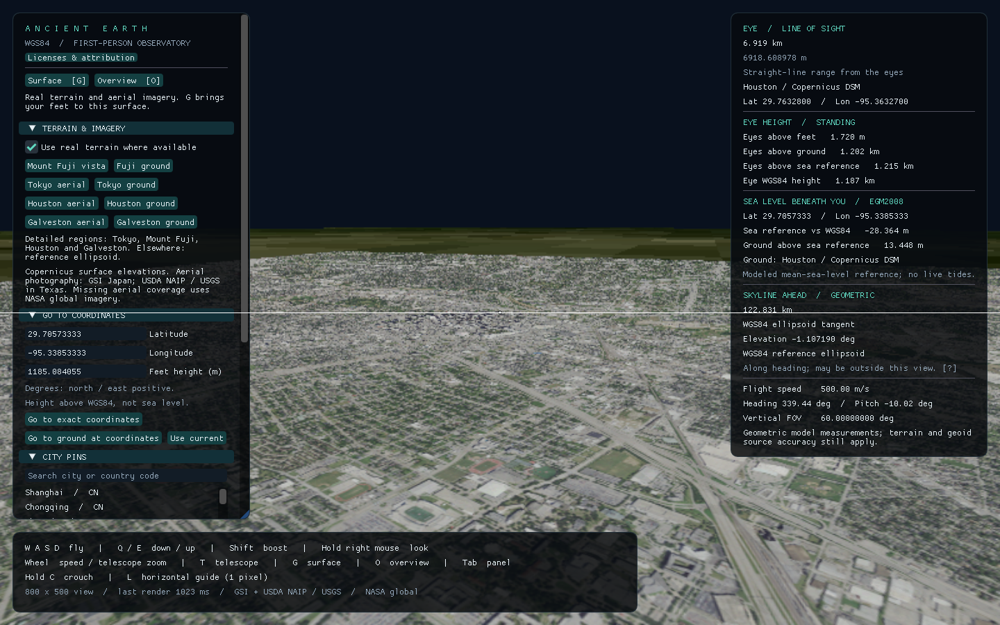

# Validation record

## Weather, terrain and survey delivery checks — 2026-10-25

The centralized `cargo test --workspace --all-targets --locked --offline` delivery run passed **345 groups: 276 mathematics and 69 application**, with zero failures and seven opt-in groups ignored (five mathematics, two application). The complete [delivery log](../../artifacts/refraction-delivery-tests.log) includes the new optical endpoint-contact regression and shared backend-eligibility lifecycle test. Mathematics and application totals are summed from the actual result lines, without counting focused reruns again. Earlier 341/343-group logs remain historical checkpoints in [scientific verification](../science/verification.md#weather-source-and-curved-scene-review). This test result does not establish arbitrary-ray convergence, graphics-driver support or interactive rendering speed; the separate native evidence below retains its backend and performance limits.

Strict all-target Clippy and formatting checks passed for the delivery source. The asset audit passed for all **142 registered assets**, including the reviewed NOAA regional fixtures and native captures; software and embedded-font notices also verified. No new dependency or font was added for this refraction change. Windows delivery uses `scripts/package_windows.ps1` so provider notices, provenance, source terms and project documentation accompany the executable.

## Regional weather transport smoke — 2026-10-25

The real application transport, exercised through `cargo run --example weather_download --no-default-features`, accepted an HRRR 17:00 UTC run at forecast hour 3 together with a GFS 12:00 UTC run at forecast hour 8. Both products have the same 2026-10-25 20:00 UTC valid time. The first run downloaded the pair and passed source-identity, registration and composite checks; the second reused both validated caches. The [retained fresh/cache observations](../../artifacts/weather-live-validation.txt) record both outcomes. Source URLs, original-byte checksums and acquisition times are retained in `.cache/weather-regional-live/{gfs,hrrr}/latest.json`. The example uses the same request planning, decoder, composite checks, eligibility and fixed scene registration as the app, without starting the GPU renderer. This is transport/cache integration evidence, not a station observation, a proof of atmospheric accuracy or native optical rendering evidence. Frozen registered fixtures and independent numerical/source checks are described in [scientific verification](../science/verification.md#weather-source-and-curved-scene-review).

The full-resolution Vulkan [runtime capture](../../artifacts/performance/refraction-terrain-vulkan.json) completed, but remained slow: independent exact-decimal review confirms **47 frames over 20.3328925 s**, **2.3115 frames/s**, **431.5612 ms** median, **443.0484 ms** nearest-rank p95 and **444.6949 ms** maximum. Its [summary](../../artifacts/performance/refraction-terrain-vulkan-review-summary.json) retains all intervals. This was a stationary debug build on an AMD Radeon RX 7900 XTX with Vulkan 26.8.1, 1920×1080, AutoVsync, the default 60-FPS limit, 60° rectilinear view, panels visible, imported terrain and 81 markers. The fixed NOAA verification profile is intentionally separate from the paused astronomical date; this is not a live-weather capture. All recorded frames were focused and presentation-ready, with unchanged view state after 120 warmup frames. Those application flags do not establish native-input delivery. The log also contains host Vulkan-loader messages about missing optional layer JSON files. No device loss occurred during this completed recording. These are application frame intervals, not GPU timings or a performance-improvement comparison; a successful screenshot is not evidence of responsive full-resolution flight. The [scientific record](../science/verification.md#weather-source-and-curved-scene-review) separately preserves the two failed full-resolution DX12 launches, finite Vulkan visual success, unresolved tape/pixels and compact compute checks.

After the exact bitwise fixed-point shortcut, the [final Vulkan recording](../../artifacts/performance/refraction-terrain-vulkan-fixed-point.json) completed **44 intervals over 20.1320754 s**, or **2.1856 frames/s**, with **457.24515 ms** median, **461.9843 ms** nearest-rank p95 and **467.5141 ms** maximum. The [independent exact-decimal summary](../../artifacts/performance/refraction-terrain-vulkan-fixed-point-review-summary.json) confirms all intervals and metadata. All 44 frames were unfocused, so the effective background cap was 15 FPS despite the selected 60-FPS setting. Presentation remained complete and the view unchanged. Adapter, build profile, epoch and the other recorded view settings match the earlier run, but the focus/pacing difference prevents a valid performance attribution. The focused 2.31 FPS baseline is retained; there is no demonstrated speedup or smooth-flight claim. Independent compute replays separately establish unchanged finite ray results after the shortcut, not full-frame throughput.

The [DX12 guard image](../images/refraction-dx12-geometric-guard.png) shows the explicit geometric fallback and matching measurements without overlapping backend/altitude notices. The later [Vulkan tape view](../images/refraction-terrain-tape-vulkan.png) shows the resolved stroke and both endpoints after the independently reviewed same-ray first-contact retry; sparse purple unresolved pixels still remain. The earlier Vulkan image with an unresolved-tape banner is retained separately in the scientific record. These automatic camera captures are presentation evidence, not physical-input tests or proof that every optical ray converges.

## Lunar appearance, axis, tracking and compact panels — 2026-10-24

The final `cargo test --workspace --all-targets --locked --offline` run passed **312 tests**, with seven optional groups ignored and no failures. It includes the actual embedded lunar texture loader, camera tracking during movement/time/F9 changes, toolbar click semantics, panel geometry, independent lunar source/orientation checks and the narrow-fisheye sampling regression. The complete log is `artifacts/lunar-final-tests.log`. Strict all-target Clippy passed (`artifacts/lunar-final-clippy.log`), as did formatting and diff checks. The existing 28 Python regression checks and three new lunar preprocessing groups passed using the cached verification environment.

The mathematics authors and independent reviewer approved the source processing, lunar pole/orbit-plane definitions, body aiming/tracking, panel geometry and corrected fisheye projection. [Scientific verification](../science/verification.md) records the independent calculations and finite accuracy limits. The NASA map source audit is recorded in `artifacts/lunar-map-review.json`.

Fresh native DX12 captures were inspected at original resolution: [gibbous Moon and compact controls](../images/lunar-gibbous-controls.png), [near-full telescope view](../images/lunar-full-telescope.png), [matching narrow fisheye](../images/lunar-full-fisheye.png), and [refraction](../images/lunar-refraction.png). The first narrow-fisheye capture exposed magnification of a fixed wide source image; the corrected source projection resolves the lunar surface without changing the viewing rays or physical geometry. The final captures replace the rejected images. These captures validate visual integration, not physical OS mouse double-click delivery or universal photometric accuracy; click selection and tracking state have separate automated tests.

The asset audit passed for **134 registered assets**, including all new lunar files and captures. NASA source credits, rights review, modification notices and hashes are preserved in `NOTICE.md`, `licenses/NASA-SVS-lunar.md` and the asset inventory. Software/font notices verified; this change adds no dependency or font asset. Windows packaging includes the shared lunar provenance record as `asset-provenance/lunar.provenance.json`.

Latest validation: 2026-10-24. Platform: Windows x86_64, Rust 1.97.1. Earlier records below describe their respective revisions, not the current feature set. City catalogs, pins, photographic imagery, the CPU image renderer and the separate orbit camera occur only in historical evidence. Current acceptance checks appear at the end of this document.

## Body flight controls

Q/E now roll left/right, Space/either Shift translate along body up/down, and G lands upright and level while retaining heading. Shift no longer boosts speed. The controls regression checks roll/translation separation, both Shift keys, opposing-key cancellation and precision input. Five independently authored mathematical test groups cover signed roll, pitched/banked translation, inverted terrain contact, upright landing and F9 transport. The implementation author cross-reviewed those fixtures; the independent reviewer approved source and scientific documentation. See [body-flight verification](../science/verification.md).

The suite passed **297 tests: 238 mathematics and 59 application**, with seven optional source-dependent groups ignored and no failures. Windows refused replacement of the existing `target/debug/ancient-earth.exe`, so the initial whole-workspace invocation stopped before executing tests and is not counted as a pass. The successful split commands were `cargo test --workspace --lib --bins --locked --offline`, `cargo test -p earth-math --test '*' --locked --offline`, and `cargo test -p ancient-earth --no-default-features --test '*' --locked --offline`. The last command runs the renderer-independent application integration tests without building the locked desktop binary. Logs are `artifacts/body-controls-unit-tests.log`, `artifacts/body-controls-math-tests.log` and `artifacts/body-controls-app-integration-tests.log`; their totals and successful terminal results were independently checked.

Strict all-target Clippy, formatting and diff checks passed. The updated local executable is `target/debug/ancient-earth-preview.exe`; the existing executable was left intact. Build and lint logs are `artifacts/body-controls-build.log` and `artifacts/body-controls-clippy.log`. The asset audit passed for all 127 existing reviewed assets, and software/font notices verified. No asset or dependency was added.

The fresh [native body-controller traversal](../../artifacts/performance/body-controls-traversal.json) passed independent review of the outward/return route, unchanged lens, both coordinate-anchor transitions, orbital-annotation eligibility and recorded CPU translation-error bounds. This was a 1920×1009 DX12 run using geodetic ascent/descent mapped into body controls. It verifies the shared movement path, not physical keyboard events, native image accuracy or a performance improvement. The first launch exited without producing a trace and is excluded; its sparse logs are preserved as `artifacts/body-controls-traversal-attempt1.*.log`. The retry's complete report and logs establish the native pass.

## Startup and rendering audit

The final integrated suite passed **291 tests**, with seven optional source-cache tests ignored and no failures. Strict all-target Clippy passed; all **28 Python regression checks** passed using the existing `.cache/python` verification environment. Logs are `artifacts/improvement-tests.log`, `artifacts/improvement-clippy.log` and `artifacts/improvement-python-tests.log`. The new five application readiness groups cover repeated versus distinct render reports, changing pipeline counts, pending geometry, empty caches, compiler errors, subsequent view preparation and the UI's own shader dependency. Missing and nonfinite `--view-fov` arguments were rejected before GPU startup.

Mathematics authors and an independent reviewer corrected contact navigation at the modeled Sun/Moon surfaces, preserved range-query roots, removed unused fixed-speed clearance queries, proved conservative fisheye camera eligibility and verified exact adaptive-mesh edge lookup. The measured CPU mesh-preparation improvements and unchanged geometry hashes are documented in [the scientific audit](../science/verification.md#navigation-and-exact-rendering-audit). No new external dataset, font or dependency was added.

Asynchronous graphics preparation now has an opaque initial loading screen and capture-readiness checks. The native [loading capture](../images/improvement-loading.png) shows the UI with 16 graphics pipelines still pending; its log records 82 observed pending render reports before requesting the image. Completed 1920×1080 captures cover [ground](../images/improvement-startup-ground.png), [wide fisheye](../images/improvement-fisheye-wide.png), [narrow fisheye](../images/improvement-fisheye-narrow.png), [fixed-reference refraction with L/V](../images/improvement-refraction.png) and [the annual orbit](../images/improvement-orbit.png). They completed without shader-validation, device-loss or panic errors. Fisheye images received independent projection and face-coverage review. The six original captures are registered in `licenses/assets.json`; the asset audit covers 127 reviewed assets. This verifies finite native presentation, not uninterrupted startup timing on every driver. Initial device/UI setup and later resource uploads can still pause.

The fresh [continuous traversal](../../artifacts/performance/improvement-traversal.json) passed the same 30,000 km outward/return control sequence without a fit, mode switch, pose reset or lens change. Independent review confirmed all ordered probe intervals against the raw array and recomputed the [summary](../../artifacts/performance/improvement-traversal-summary.json) from exact decimal fractions: **1,169 intervals over 20.2057779 s**, throughput **57.8547 frames/s**, median **17.3831 ms**, nearest-rank p95 **22.9020 ms** and maximum **63.2421 ms**. All 706 recorded pending/incomplete frames remain included. The application reported zero unfocused frames; that flag is not independent proof that Windows was unlocked or interactive. This is nonstationary integration evidence under the recorded debug/DX12/RX 7900 XTX, 1920×1080, AutoVsync and 60-FPS pacing configuration, not GPU execution time or a cross-revision speed claim.

The FOV remained exactly 60°, eye height reached 30,000,001.720000334 m, and final Cartesian return error was below **0.000020003 m**. Both coordinate-anchor states and both directions of orbital-annotation eligibility occurred; all fourteen mesh requests completed and committed, with none discarded or in flight at the end. Maximum CPU reconstruction error from the f32 camera translation was **1.3222 m**, rounded upward, and every frame stayed within its recorded bound (maximum error/bound ratio below 0.2497). This checks finite state/coordinate coherence, not pixel-identical GPU transitions. The log records startup readiness after **31.0650 s** and 1,071 observed pending render reports before reveal; this preparation is outside the recording. The prior multi-second ascent pause did not recur in this run, but neither startup nor arbitrary-view performance is guaranteed. The separate mouse-input limitation below still applies.

The native mouse recheck could not proceed because Windows' lock screen owned the foreground and pointer. The script refused to inject the test click; `artifacts/continuous-input-qa.json` records that failed environment precondition with its fresh timestamp. The earlier successful result is preserved separately below. The script now waits for actual graphics readiness, writes a running state at launch, and replaces it with a success or failure report so a failed attempt cannot leave stale success evidence. Cursor/capture logic unit tests passed; an unlocked-desktop rerun remains necessary to renew native mouse-input evidence for this revision.

## Continuous ground-to-space flight

The active view now uses one observer and lens from the ground through space. B no longer switches cameras. Orbit and tilt annotations become available automatically; optional overview/fit buttons reposition the same observer. Date playback, F9, terrain, aiming, measurements and F2 continue to use that observer. Left-clicking the scene captures mouse look until Escape, focus loss or a dialog releases it. Flight has adaptive speed, a precision modifier, full-direction looking and immediate stops when capture is released.

The complete workspace suite passed **281 tests: 228 mathematics and 53 application**, with seven opt-in source-cache tests ignored. Strict all-target Clippy passed. Logs are `artifacts/continuous-flight-tests.log` and `artifacts/continuous-flight-clippy.log`. Independent mathematics authors and reviewers checked navigation, distant coordinates, rendering frames, orbital annotations, the shared apparent-body packet and the declared inspection receiver convention. Definitions and limits are in [continuous flight](../science/continuous-flight.md), [rendering](../science/rendering.md) and [verification](../science/verification.md).

The opt-in Windows integration script `scripts/test_mouse_capture_windows.ps1` targets its own graphics window by process and title. The successful native run verified a visible cursor before interaction, a hidden cursor after a background left-click and button release, and a visible cursor after Escape. That baseline report is preserved as `artifacts/continuous-input-qa-before-graphics-loading.json`. Dear ImGui's final cursor request now agrees with Bevy's capture state; unit checks separately cover GUI clicks, focus loss, modal release and the locked cursor property. The native script temporarily activates its own window and restores the pointer afterward.

Fresh native screenshots show the [ground controls](../images/continuous-ground-controls.png), [globe](../images/continuous-globe.png) and [annual orbit](../images/continuous-orbit.png). Each uses the same runtime camera path; the latter two use optional starting-position presets for repeatable captures. They are presentation checks, not a recording of the traversal below. All three completed without shader validation, device-loss or panic failures and received independent visual review. Their original pixels, source provenance and SHA-256 hashes are registered in `licenses/assets.json`; no new external asset, dataset, font or dependency was introduced by this change.

The final native [continuous traversal report](../../artifacts/performance/continuous-traversal.json) uses the same `FlightController`, observer and lens throughout: six command seconds upward and downward at 5,000,000 m/s, adaptive speed disabled, input steps capped at 0.1 s, and three continuously ready settlement seconds at each end. No fit, camera-mode change, pose reset or lens change occurs. The run starts at 1.72 m eye height, reaches 30,000,001.72 m and returns within 0.000020002 m in Cartesian position. The recorded FOV stays exactly 60°. Both coordinate-anchor states and both directions of orbital-annotation eligibility were observed. These are finite native integration and CPU state checks; they do not establish pixel-identical GPU images at a transition.

The fixed space anchor committed at about 9,385 km eye height, and the near anchor returned after descent at the final ground pose. These are completed asynchronous snapshot transitions, not claims that uploads occur exactly at the 2,000/1,000 km request thresholds. Annotation eligibility turned on near 7,751 km and off near 7,579 km for this lens and sampled path. The maximum CPU reconstruction error from the actual f32 camera translation was 1.3596 m; every frame stayed within its recorded scale-aware bound, with maximum error/bound ratio 0.2461. Fourteen mesh snapshots were requested, completed and committed; none were discarded or in flight at completion.

The original and final captures used Windows DirectX 12, an AMD Radeon RX 7900 XTX (driver 32.0.31041.1004), the debug executable, 1920×1080, AutoVsync, the default 60-FPS pacing policy, paused 2026-10-21 18:00 UTC, smooth WGS84, weather and grass disabled, and clean view. The [original report](../../artifacts/performance/continuous-traversal-before-profile.json) retains 1,124 intervals over 31.8759803 s, including a 12.3747136-second early-ascent pause. The final report retains 1,158 intervals over 20.0039672 s: 57.8885 frames/s throughput, 17.02665 ms median, 22.3247 ms nearest-rank p95 and 61.6814 ms maximum. All frames in both captures were focused; all 606 original and 654 final pending/incomplete presentation frames remain included. Independent exact-decimal sums agree with the [original summary](../../artifacts/performance/continuous-traversal-before-profile-summary.json) and [final summary](../../artifacts/performance/continuous-traversal-summary.json). The analyzer verifies ordered one-to-one agreement between probe samples and raw intervals and rejects both runs as stationary baselines.

| Phase | Samples before → after | Recorded seconds before → after | p95 interval, ms before → after | Maximum interval, ms before → after |
| --- | ---: | ---: | ---: | ---: |
| Ascent | 339 → 346 | 18.2920969 → 6.0089700 | 24.0307 → 22.5624 | 12374.7136 → 61.6814 |
| Far settlement | 177 → 205 | 3.0223325 → 3.5063752 | 21.5305 → 21.4611 | 25.8446 → 47.3351 |
| Descent | 348 → 348 | 5.9993831 → 6.0082180 | 21.9076 → 21.8616 | 53.5871 → 55.1625 |
| Near settlement | 259 → 240 | 4.5490774 → 4.1552297 | 23.7493 → 22.9053 | 61.4145 → 54.0184 |

The original run additionally contains one 13.0904 ms recording-boundary interval. The final run additionally contains one 22.6082 ms boundary interval and 18 completed-dwell intervals totaling 0.3025661 s. Phase attribution follows the preceding action, so recorded phase duration need not equal command duration. Aggregate throughput includes different recovery/dwell proportions and is not an isolated rendering-speed ratio.

Two intervening diagnostic replays localized the pause. `continuous-traversal-render-profile.json` and its stderr log measured a 12.2301 s frame against a 12.2242 s render-stage bracket; main-world renderer calls stayed below 5.718 ms and completed preparation jobs ran on a different thread. The further `continuous-traversal-pipeline-profile` report/log measured 12.1145 s inside synchronous pipeline queue processing, compared with 12.1270 s in its enclosing render bracket. This extra diagnostic queue call changes scheduling by adding a processing attempt and is excluded from the ordinary before/after comparison. The logged descriptors and independent source review identified unused legacy water/ground entities whose zero-area indexed placeholders became frustum candidates when the origin entered view. They now remain hidden when classifier-owned chunks supply the actual surface; disabled or empty grass also stays hidden. No physical source face, elevation, sampling or camera model was changed.

The final replay uses the normal pipeline queue schedule. Its longest renderer-main call was 4.840 ms, mesh publication 4.788 ms and completed background preparation 972 ms; those are CPU-side elapsed wall durations, not GPU execution times. The original multi-second ascent pause was absent in this finite replay. **First-use compilation remains a startup cost:** the final log records 4.5228 s and 20.3326 s render-stage intervals before recording began. The successful flight does not establish universally smooth motion, complete GPU upload atomicity, an arbitrary-view performance guarantee or a sustained 60 FPS result.

## Previous separate globe/orbit inspection

**B** opens the independent globe/orbit camera; wheel dolly, right-button orbit, **Fit Earth [O]**, **Fit whole orbit** and body-aim controls are available. **Aim at Earth** is also available in first-person mode. The existing calendar and playback controls drive the overview. Returning restores the saved first-person observer, with tracking reanchored at the selected epoch. Completed topography downloads wait to activate until first-person mode resumes, preserving the parked pose during inspection.

The full workspace checkpoint passed **265 tests: 215 mathematics and 50 application**, with seven source-cache opt-in groups ignored. The subsequent independently reviewed measured-caption fixture also passed, bringing the combined result to **266 tests: 216 mathematics and 50 application**. All-target strict Clippy passed; the final caption changes also passed focused strict math Clippy. Logs include `artifacts/orbit-tests.log`, `orbit-rendering-final-tests.log` and `orbit-clippy.log`. Independent review covers ephemeris states, orbital-plane and pole definitions, the dated trail, camera projection, actual GPU upload values, parked-observer lifecycle, and shared caption placement at normal/high-DPI scaling. The source references, tolerances and finite display limits are recorded in [orbital overview mathematics](../science/orbital-overview.md) and [scientific verification](../science/verification.md).

Native DirectX 12 captures at 1920×1080 show [global geography and the labeled axis/plane](../images/orbital-globe-tilt.png) and [the existing high-altitude first-person globe](../images/globe-flight-overview.png). These use paused 2026-10-21 18:00 UTC, smooth WGS84 and weather disabled. They check presentation and global map coverage, not real-world coastline accuracy. The overview reuses the licensed global boundaries and existing astronomy data; no new dataset, dependency or font was added. Original screenshots retain their source credits and checksums in `licenses/assets.json`.

The [whole-orbit capture at 1.5× UI scaling](../images/orbital-path-hidpi.png) shows the dated path, tiny-body locators and enlarged direction annotations with separately readable captions. The [controls capture](../images/orbital-controls.png) exposes aiming, camera fitting, calendar/playback and the orbital measurements pane. Captions share a measured placement pass and retain leader lines to unchanged anchors. Final native runs completed without shader, validation, device-loss or panic failures. The host's existing monitor/gamepad diagnostics and cursor-release access warnings remain in the logs. These captures verify rendering and presentation, not exhaustive manual control interactions or a sustained frame-rate benchmark.

## Independent panel collapse and astronomical information

The left, right and bottom panels now have independent edge controls with visible restore arrows. Tab remains a navigation toggle; F2 preserves all three panel states. Collapsing the measurements panel cancels its background skyline work while leaving enabled L/V guides available. **I** opens or closes a separate Earth/Sun/Moon information window, including in clean view. Keyboard regression coverage checks typing suppression, press-edge behavior, mouse-look release and preservation of collapsed panel states through F2 and Tab.

The complete workspace suite passed **253 tests: 207 mathematics and 46 application**, with seven source-cache opt-in groups ignored. Strict all-target Clippy, formatting and whitespace checks passed. Logs are `artifacts/panels-info-tests.log`, `panels-info-clippy.log` and `panels-info-check.log`. The information formulas, unit conversions, source definitions and pixel-aligned responsive layout received independent mathematical review; see [scientific verification](../science/verification.md) and [information definitions](../science/astronomy-info.md).

Fresh native DirectX 12 captures at 1920×1080 show [expanded panels and exposed arrows](../images/panels-expanded.png), [all panels collapsed with restore arrows](../images/panels-collapsed.png), and [the astronomical information window in F2](../images/astronomy-info-clean.png). The Earth tab displays paired units, sample quality, current rotation and a scrollbar for the remaining notes and sources; F2 retains its existing eye-height caption. These captures use paused 2026-10-21 18:00 UTC, smooth WGS84 and weather disabled. They verify native presentation, not external physical accuracy or exhaustive mouse interaction. All runs completed without shader, validation, device-loss or panic errors; the host's existing monitor/gamepad messages remain in the logs. The three original screenshots are registered with reviewed source provenance in `licenses/assets.json`; no new dataset, dependency or font was added.

## View reset, capped downloads and numbered markers

The **R** shortcut and **Reset view [R]** button restore the default rectilinear lens and exit telescope mode, retaining the observer and stored telescope zoom. Keyboard regression coverage includes clean view and suppression while typing. The topography radius cap is enforced in conversion, request construction and source planning, including cached selections; marker-row distances retain their separate limits. The right-pane Eye Height and Datum Reference sections use the independently reviewed whole-feet/inches formatter in Imperial mode, retaining the existing parenthetical miles and unchanged metric readouts.

The mathematical implementation and its tests were independently reviewed. **245 unique tests passed: 200 mathematics and 45 application**, across the complete workspace run and the subsequently added sign fixture. Seven source-cache opt-in groups stayed ignored. After the final sign-placement adjustment, the survey, annotation and sign fixtures and the reset shortcut were rerun successfully. Strict all-target Clippy passed. Evidence is retained in `artifacts/view-marker-updates-tests.log`, `view-marker-sign-tests.log`, `view-marker-final-survey-tests.log`, `view-marker-final-shortcut-test.log` and `view-marker-updates-clippy.log`. The detailed review is in [scientific verification](../science/verification.md).

The native [numbered-marker capture](../images/survey-numbered-signs.png) shows the complete 0001 plate above the original marker body, matching hover/tape labels, and the updated readouts. The [default-height capture](../images/height-feet-inches.png) shows the whole-feet/inches formatting and the maximum download radius. Captures use fixed 2026-10-21 18:00:00 UTC on smooth WGS84 with weather disabled. They retain source attribution in the asset inventory; the original generated number plates require no imported fonts or textures.

The [clean fisheye capture](../images/survey-numbered-fisheye.png) verifies the upright sign through the alternate camera path, with the existing F2 Height caption and tape retained. All three native runs completed without shader, validation, device-loss or panic failures. Their logs retain the host's existing monitor-selection warning and skipped gamepad-device error; these did not prevent capture. Native screenshots check presentation, not real-world survey accuracy.

## Original vector coasts, spatial draws and frame pacing

The smooth global fallback previously sampled Natural Earth into 0.01° cells. The current derivative retains the original geographic polygon segments in a bounded adaptive index. The paired native [raster-before](../images/coast-vector-before.png) and [vector-after](../images/coast-vector-after.png) captures remove the large regular staircase without inventing finer source detail. Regional WBM retains priority and its differing source detail remains visible. The [Rocky Mountain terrain view](../images/rockies-terrain-detail.png) confirms that licensed downloaded elevations remain active, with separate WGS84 and EGM2008 readouts. A QA inspection-camera defect was corrected: its 2 km neighborhood is now geographic rather than a three-dimensional radius from WGS84 h=0, which had rejected mountain posts. The [optical coast capture](../images/coast-vector-optical.png) checks the shared classifier in the separate curved-ray renderer.

Ordinary mathematical and application suites pass **239 tests: 195 math and 44 application**, excluding seven cache-dependent opt-in groups. The app results are saved in `artifacts/vector-app-tests.log`; the passing math run adds three original-vector and two exact draw-partition groups to the preceding 190. All five classification review groups, including two source-dependent groups, also pass explicitly. Strict all-target Clippy passes. The source audit checks every one of the **503,417 indexed fragments**, all **101,265 seeds**, and **708,855 independent original-OGR CPU queries**. The scalar f32 review reports its finite Antarctic boundary differences explicitly. Complete source methods, numerical bounds and test commands are in [scientific verification](../science/verification.md#original-vector-coastline-and-exact-draw-partition-review).

Spatial draw partitioning preserves the complete oriented face and attribute multiset. Per-chunk bounds replace the old Earth-spanning regional/imported AABB without reducing source geometry. Chunk buffers, bounds and local coordinates commit together; finite upload readiness remains documented. In the later recorded Rocky view, Bevy reported 65 prepared Earth draws and two view-eligible draws containing 279,929 faces. These are previous-frame engine visibility statistics, not hardware draw calls, vertex execution counts or GPU timing. The older capture lacks corresponding visibility metadata, so no numeric draw-count speedup is inferred.

The following raw application intervals were independently recomputed. Both runs use the supplied Rocky coordinate, smooth h=0, paused 2026-10-21 18:00 UTC, 1920×1080, default visible UI/grass, quality 1, geometric weather-off rendering, DirectX 12, debug build, an RX 7900 XTX and AutoVsync. The older binary has no application pacing gate; the current binary uses `--frame-pacing-unrestricted`, keeping all new foreground/background caps disabled. All intervals are retained.

| Capture | Frames / duration | Throughput | Median | p95 | Maximum | Unfocused frames |
| --- | ---: | ---: | ---: | ---: | ---: | ---: |
| `rockies-pdh-before.json` | 1,095 / 20.0003391 s | 54.749 FPS | 19.1013 ms | 25.6799 ms | 38.3502 ms | 0 |
| `rockies-pdh-after.json` | 1,101 / 20.0014320 s | 55.046 FPS | 19.0324 ms | 25.0719 ms | 44.3335 ms | 193 |

Both views stayed unchanged and recorded no incomplete scene frames. The later run lost focus and is **ineligible as a strict stationary baseline**. These single runs do not establish an overall performance improvement, an isolated chunking benefit, or GPU utilization reduction. Throughput is count divided by the sum of raw intervals; p95 uses the nearest-rank definition. Raw files and the frame comparison are retained under `artifacts/performance/`.

The ordinary pacing policy now targets 60 foreground FPS, with 30/60/120/Unlimited choices, 15 when unfocused and 5 when minimized. These are upper-rate targets, not guaranteed performance. Pacing preserves real elapsed time and never schedules catch-up bursts. Reduced utilization from a cap must be described separately from rendering efficiency. The independent synthetic-clock tests cover all policy combinations and late/rate-switch behavior.

The first GPU-counter attempt restarted its PDH query per poll; a second continuous wildcard attempt began before this process registered its counters. Their zero/empty results are inconclusive. The reviewed collector now discovers the process's actual engine paths, keeps one query open, retains status/timestamps, and records recoverable per-sample data. The analyzer reports complete consecutive valid intervals per engine, including valid zeros and flagged values above nominal 100%, with coverage and gaps. It never sums engine percentages. UTC application boundaries and a two-second interior guard align a conservative observation window; the guard is a QA convention rather than hardware clock synchronization. Engine-busy counters are distinct from application FPS, shader execution time and power.

The recovered persistent-query records provide the following **per-process 3D-engine** observations on the same adapter. Means are weighted by interval duration over covered intervals only. Each row contains 15 valid consecutive intervals; coverage refers to the approximately 16-second guarded window, not the full frame recording.

| Capture / policy | Covered seconds | Window coverage | Mean busy | Largest interval busy |
| --- | ---: | ---: | ---: | ---: |
| Before, no application gate | 15.1336 s | 94.58% | 21.742% | 23.868% |
| After, unrestricted | 15.1030 s | 94.39% | 20.045% | 21.971% |
| After, default policy | 15.0989 s | 94.32% | 16.378% | 21.817% |

The other seven discovered engine instances report valid zeros over the same selected intervals; percentages are not combined. Collection errors and uncovered time remain in the reports. These are the discovered process engine counters, not whole-device utilization or a guarantee about unobserved engines, transients or other processes. The reported 100% condition was not reproduced in these selected 3D-engine intervals. Focus differences prevent attributing the lower after mean to chunking alone.

The default-policy recording, `rockies-default-limit.json`, retained 966 intervals over 20.0082627 s: 48.280 FPS throughput, 19.1767 ms median, 55.0234 ms p95 and 253.4761 ms maximum. It began with the foreground limit set to 60, but recorded 59 unfocused frames, changed view metadata and 51 incomplete scene frames. It is **ineligible as a stationary baseline** and does not establish either a steady 60-FPS result or a controlled utilization benefit from the cap. The unrestricted pair and this policy run retain every interval. The final frame comparison and three `*.gpu-analysis.json` files are saved beside their raw frame, counter and UTC log files in `artifacts/performance/`; a separate exact-decimal timestamp/interval recomputation agrees with all displayed rounding.

F2 clean view now retains a top-right `Height` caption. Independent source review confirms it uses the existing active-scene vertical report and paired-unit height formatter: eye height minus the canonical surface height beneath the observer at the same geodetic latitude/longitude. Crouching, flight and enabled terrain therefore retain their existing meanings. This is geodetic-normal clearance, not eye height above the feet, EGM2008 height or a refracted path length. The caption is drawn before the clean-view return and uses the existing measured-text layout helper.

The native [Imperial clean view](../images/clean-height-imperial.png) shows `5.643 ft (0.001069 mi)`, matching the 1.72 m standing eye clearance. The [metric crouched view](../images/clean-height-metric-crouch.png), with L/V and 1.5× display scaling, shows `1.000 m (0.001000 km)`. Original-resolution inspection confirms that both top-right Height captions are complete and readable at 1920×1080.

## Downloaded land/water coverage

The reported small coastal rectangle came from the bundled category crop, while the larger downloaded elevation scene was already present. The updated transport was exercised against an isolated copy of the reported 100-mile cache: existing elevation files were reused, and matching water masks were downloaded with package-license, metadata, checksum and provenance validation. The user's original cache was left unchanged. Old-cache offline loading remains supported; adding previously absent masks requires **Download + enable** once.

Unmodified native DirectX 12 screenshots verify [expanded coverage with elevations](../images/topography-wide-area.png), [the same view with smooth geometry](../images/topography-wide-smooth.png), and [the optical coast renderer](../images/water-context-weather.png). Both wide views use the math-authored reproduction of the reported camera pose. They show continuous coast/bay categories beyond the old rectangle. The smooth view retains the downloaded categories. The separate faint elevation-coverage edge in the terrain view remains an explicit physical fallback limitation; its source interpretation is recorded in the scientific documentation. No heights were altered to hide it.

The source decoder, categorical preparation and rendering coordinate work were independently reviewed. Full native-sample agreement, global polygon/raster checks and finite precision limits are recorded in [scientific verification](../science/verification.md). All three captures and the new public-domain Natural Earth derivative are registered with source attribution and checksums. Asset audit passed for **101 assets**, and software/font notices remained current. No dependency or font changes were needed.

The ordinary workspace all-target run passed **231 Rust tests**, with the source-cache audit groups kept opt-in. All **three scalar shader-packing review groups**, including the cached-source group, passed separately. Results are retained in `artifacts/wide-area-tests.log` and `artifacts/wide-area-gpu-review.log`. Strict all-target Clippy and formatting passed. Native captures completed without shader validation errors. The source transport regression checks cover verified cache reuse, independent elevation/water entries, corrupted masks, reviewed endpoint enforcement and cancellation before mutation.

Reproduce the wide native views with `--topography-wide-view`, adding `--topography-smooth` for the smooth comparison. Set `ANCIENT_EARTH_TOPOGRAPHY_CACHE` to a completed, reviewed cache. `--coast --weather-reference` exercises the fixed optical verification profile. These QA flags do not change the ordinary startup location.

## Asynchronous terrain presentation, nearby markers and tape overlay

The final workspace all-target run passed **225 Rust tests**: **186 mathematics** and **39 application** tests. Both cached-source groups excluded from the ordinary run passed separately. Strict all-target Clippy and Rust formatting passed. Logs are `artifacts/view-fixes-tests-final.log`, `artifacts/view-fixes-clippy-final.log` and `artifacts/view-fixes-build-final.log`. The license-check and frame-analysis Python suites passed, and the independent survey fixtures reproduced unchanged. Mathematical implementation and scientific documentation were independently reviewed.

Unmodified native captures verify the [nearby first marker and thin tape](../images/survey-tape-overlay.png), [fisheye tape in clean view](../images/survey-tape-fisheye.png), and [retained coastal terrain detail](../images/topography-local-detail.png). The nearby view keeps the requested startup feet position and turns toward station zero. The terrain inspection uses the existing completed download without changing its cache. All captures received visual review and retain provider attribution and file hashes in `licenses/assets.json`.

Independent review checked the complete display snapshot: each worker packet owns its immutable physical scene, local coordinate frame and converted meshes. A completed compatible packet remains useful after camera movement; it commits before a newest-view request is prepared. Camera pose and projection respond while the previous coherent display remains available. Scene changes hide incompatible Earth geometry. The two-origin desktop fixture compares actual prepared canonical terrain vertices against an independently expanded ENU transform, and distinguishes a mismatched frame by more than 500 m. Pinned Bevy 0.20 removes an old render asset before preparing its modified replacement and skips unavailable meshes. This prevents old vertex buffers from being interpreted in a new frame; GPU upload can still temporarily omit geometry. These checks do not promise an indivisible GPU upload or eliminate every frame stall.

The reproducible zoom/ascent probe recorded the same initial pose and commands in [`view-baseline.json`](../../artifacts/performance/view-baseline.json) and [`view-after.json`](../../artifacts/performance/view-after.json). Both used Windows DX12, an AMD Radeon RX 7900 XTX, driver 32.0.31041.1004, the debug executable, 1920×1080, AutoVsync and quality 1, with grass, visible panels, weather and L disabled. Each phase supplied four seconds of commands: zoom in/out at four wheel lines per second, then ascent at 250 m/s. Command time is capped at 0.25 s per update; every actual frame interval remains recorded. Both attained approximately 5.443077197° then 60° vertical FOV and eye height 1007.7199999 m. The `passed` result means command completion and three continuously ready recovery seconds, not a certified frame rate.

The independently reviewed [analyzer](../../scripts/analyze_frame_capture.py) checks exact ordered agreement between probe and raw frame intervals and recomputes each phase. Its nearest-rank p95 and maxima are:

| Phase | Samples before → after | Recorded seconds before → after | p95 interval, ms before → after | Maximum interval, ms before → after |
|---|---:|---:|---:|---:|
| Zoom in | 19 → 213 | 20.8020 → 4.0054 | 2534.3590 → 24.3253 | 2534.3590 → 89.2502 |
| Zoom out | 16 → 208 | 27.2927 → 4.0427 | 3520.8135 → 25.5750 | 3520.8135 → 98.2560 |
| Ascent | 54 → 189 | 10.7526 → 3.9810 | 811.1188 → 29.4702 | 836.3827 → 52.4846 |

Intervals are assigned to the action preceding that frame, so phase duration need not equal command duration. Across all retained intervals, the before run recorded 251 frames in 61.8804340 s (4.0562 frames/s); the after run recorded 1,043 in 20.0180391 s (52.1030 frames/s). These aggregates include different recovery/completed dwell proportions and are not an isolated tessellation speedup. The before run was unfocused for 231 frames and the after run for all 1,043; neither qualifies as a focused stationary baseline. The after run retained all 652 frames with pending presentation work, finished with 12 completed/committed snapshots, zero discarded and none in flight. Its worst retained frame was 98.2560 ms. The evidence supports removal of the observed multi-second synchronous zoom/ascent stalls in this finite scenario, not universal responsiveness, GPU timing or a 60-fps guarantee. Raw reports and generated `view-*-summary.json` remain available for reanalysis.

The completed user-selected 100-mile cache was read without alteration. Its request center is the ordinary startup location. The revised import produced 11 terrain patches, 311,923 retained posts including shared tile duplicates, and 618,560 canonical triangles. A 30-arcsecond background lattice remains; 151,838 additional original posts provide 1-arcsecond detail in the 5,000 m request-center enclosure, whose bounding cells can extend outside that radius. Twelve requested/source-support files are unavailable; their coverage remains explicit fallback. Independent GDAL/PROJ checking of every retained post found a maximum 4.66 nm numerical height disagreement under the isolated constant-geoid test fixture, and all 1,445 duplicated tile posts were bit-identical. Exact integer parameter-area, edge incidence, winding and boundary checks passed. These are implementation tolerances, not source survey accuracies. A separately identified native post at 29.3069444444°, −94.7722222222° retains its original EGM2008 height 17.91387558 m; no vertical exaggeration or invented relief was introduced. [Scientific verification](../science/verification.md#local-source-detail-and-conforming-transitions) records the datum isolation, source checks and remaining finite-resolution limits.

## Tape measure, marker rows and requested startup

The workspace all-target run passed **218 Rust tests**: **180 mathematics** and **38 application** tests. One cached-source audit remains intentionally opt-in, as recorded in the earlier terrain work. Strict all-target Clippy and formatting passed. Logs are `artifacts/survey-tests-final.txt` and `artifacts/survey-clippy-final.txt`. New interaction regressions cover opening the marker menu without spawning, keyboard capture, tape A/B/reset/hide state, and weather-profile preservation across survey fallback. Independent scientific fixtures cover direct geodesic stations, prism picking, centerline occlusion, tape distances and rendering geometry; see [the review evidence](../science/verification.md#survey-marker-and-tape-review).

Native DX12 checks at 1920×1080 include the [placement dialog](../images/survey-marker-menu.png), [resolved close marker and tape](../images/survey-close-tape.png), and [partly hidden distant marker](../images/survey-horizon-hidden.png). The ordinary startup is the requested `29.305549, -94.767015` ground location. Independent native-image checks found the expected resolved paint bands and coherent range/hidden-height readouts. These captures establish model integration, not real-world accuracy or a frame-rate guarantee. No external object assets, software dependencies or fonts were added; generated survey appearance uses original project code. Screenshots retain their scene-source credits and hashes in the asset inventory.

The [ordinary row view](../images/survey-row-default.png) exercises the same asynchronous placement request used by the menu and confirms 80 accepted markers at the default pose. The [fisheye clean view](../images/survey-fisheye-clean.png) keeps survey captions and L/V visible with the panels hidden. A fixed weather profile is loaded and the geometric fallback is explicitly displayed. The final control layout keeps all tape buttons visible. All retained captures are unmodified native output.

## Optional downloads, default controls and single-pixel stars

The workspace run passed **204 Rust tests** (171 mathematics and 33 application tests), with the explicit cached-source scientific audit run separately. The source importer and radius/unit/scintillation models were authored by mathematics agents and independently reviewed. The [scientific verification record](../science/verification.md) documents independent PROJ, GDAL and high-precision reference checks, including their finite tolerances.

Live HTTPS verification used the same public application lifecycle as the panel. A small request near Houston downloaded **79.6 MB** of official source/support tiles, activated the imported scene, reloaded it offline and toggled between terrain and smooth WGS84. A separate **100-mile estimate** at latitude 29.7, longitude −95.3 reported **668.6 MB**, including whole tiles/support files; sizes vary by request and exclude small notices/metadata. The coastal visual test uses **33.7 MB** of source files. All cache raster, XML, provenance and reviewed-license hashes were verified. Tests also reject unauthorized endpoints, changed payloads/licenses and cancelled requests.

The [download panel capture](../images/topography-download-enabled.png) shows enabled elevations and Imperial paired-unit height readouts with weather loaded and geometric terrain viewing. The [default-guide capture](../images/guides-imperial-default.png) uses only `--line` to enable both L and V in clean view, with no units override. The fixed-phase native star pairs cover [normal](../images/stars-pixels-normal-0.png), [fisheye](../images/stars-pixels-fisheye-0.png) and [weather-refraction](../images/stars-pixels-optical-0.png) views. Their native pixel measurements and limitations are recorded in the scientific report. The default-control regressions verify that L enables V, that V remains independently toggleable, and that clean view preserves guide controls. Terrain measurements use cancellable workers and invalidate when the active surface changes.

Native testing caught and corrected an ECS resource conflict from duplicate shader-buffer access. The renderer now shares one resource borrow between the terrain and optical paths. Shader validation, native DX12 captures, strict Clippy, formatting, license checks and the license/frame-analysis Python regressions accompany this revision. Screenshot startup duration is not a frame-rate benchmark; no new performance claim is inferred from these captures.

## Previous visible-horizon performance and Gaussian-star revision

The final workspace run passed 189 Rust groups, including 158 mathematics groups and three background-worker lifecycle groups. Strict all-target Clippy, formatting and the nine license/frame-analysis Python checks passed. The worker tests exercise cancellation, replacement without a backlog, completed-result reuse, disabling and returning to a previously cancelled snapshot. Scientific code and the separately authored guide/star tests received independent review; sources, bounds and measured search timings are recorded in [mathematical verification](../science/verification.md).

Native DirectX 12 captures verify the [geometric guide](../images/guides-fast-geometric.png), [HiDPI fisheye guide](../images/guides-fast-hidpi.png) and [refracted telescope guide](../images/guides-fast-weather.png). All retain the one-physical-pixel L/V drawing behavior in clean view. The fixed-phase night pairs show [geometric phase 0](../images/stars-geometric-phase0.png) / [phase 0.4](../images/stars-geometric-phase04.png) and [refracted phase 0](../images/stars-refracted-phase0.png) / [phase 0.4](../images/stars-refracted-phase04.png). Independent pixel checks found stable star footprints with individual brightness changes in these finite examples. They do not establish calibrated stellar photometry or actual local optical turbulence.

Native testing caught a DirectX FXC shader-unrolling failure that standalone WESL/Naga validation had not exposed. Replacing dynamic vector-component writes with an equivalent explicit phase vector fixed it; the corrected shader passed both FXC compilation and native optical captures. Every retained capture is unmodified and registered with reviewed source credits and hashes in `licenses/assets.json`.

The before/after native movement runs used the same **debug build profile, DirectX 12, Radeon RX 7900 XTX, 1920×1080, AutoVsync, geometric optics, clean view and L/V enabled**. The bounded QA sequence includes flight, a floating-origin rebase, grass regeneration, a quality change, disabling/re-enabling grass and recovery. Both runs passed those state-transition checks, with matching rendered-blade/range-bound counts, and neither recorded an unfocused frame.

| Mixed movement run | Frames / duration | Aggregate throughput | Median interval | 95th percentile | 99th percentile | Maximum interval |
| --- | ---: | ---: | ---: | ---: | ---: | ---: |
| Before | 864 / 20.0118 s | 43.17 FPS | 18.919 ms | 35.351 ms | 74.343 ms | 848.833 ms |
| After | 1033 / 20.0183 s | 51.60 FPS | 17.569 ms | 23.592 ms | 26.945 ms | 749.179 ms |

These independently recomputed figures use every interval in `artifacts/performance/guides-before-motion.json` and `guides-after-motion.json`, including 367 and 385 frames respectively while presentation was pending. They measure combined application pacing, grass/mesh work and navigation; they are **not stationary baselines, GPU execution timings or an isolated measurement of the guide optimization**. The paired run improved, but substantial stalls remain. The separate CPU guide microbenchmark in the scientific verification record isolates the calculation more closely and states its own finite-run limitations.

## Repository publication screenshots

Three fresh, unmodified native DirectX 12 captures accompany the initial full-project publication: [ground and grass](../images/github-ground.png), [weather controls](../images/github-weather.png), and [F2 with L/V](../images/github-clean-guides.png). They were captured and inspected at 1920×1080 before pushing the repository. The weather view uses the explicitly labeled fixed NOAA verification snapshot; the high-altitude clean view identifies geometric fallback. Source terms, credits and hashes are retained in the asset inventory. No runtime or scientific equations changed for publication.

The repository's `.gitattributes` preserves exact asset, provenance, license-source and lockfile bytes across Windows and Unix checkouts. Build outputs, mutable weather caches and temporary QA artifacts remain excluded from Git.

## Optional live weather and clean-view guides

**Weather & Refraction → Enable weather refraction** now controls NOAA GFS ingestion and the curved-ray display. It starts disabled. Live profiles follow the in-app observer location and real computer UTC; the astronomy calendar remains independent. Downloading, stale data, source times and failures have explicit status. The fixed verification snapshot requires the separate `--weather-reference` option and is never a silent network fallback. F2 hides panels and the dot while preserving independent L/V toggles, captions and adjustment.

All **176 Rust workspace tests** passed, including **148 mathematical test groups**, of which **14** cover atmospheric optics and independent review. Strict all-target Clippy and formatting passed. Logs are `artifacts/weather-tests-final.log`, `artifacts/weather-clippy-final.log` and `artifacts/weather-review-final.log`. The final formatting correction affected test assertions only. Environment-specific incremental-cache hard-link warnings used the successful copy fallback.

Mathematics specialists implemented the optical model, weather mapping, shader and guide integration; a separate reviewer checked equations, numerical cases, source decoding and display behavior. Independent GDAL/Rasterio decoding reproduces the registered NOAA fixture with `python scripts/verify_weather.py --check`. The [scientific verification record](../science/verification.md#optional-weather-informed-optical-paths) states the fixtures, tolerances and finite accuracy limits. Passing these checks does not certify the atmosphere at a real observer's location.

Native DirectX 12 captures were inspected at 1920×1080:

| Capture | Observed behavior |
| --- | --- |
| [Weather controls and coast](../images/weather-reference-coast.png) | Explicit verification source, enable toggle, timestamps, atmospheric measurements and smooth surface |
| [Refracted horizon](../images/weather-horizon-refracted.png) / [geometric comparison](../images/weather-horizon-geometric.png) | Magnified model horizon shifts with refraction; the one-pixel L guide remains aligned |
| [F2 with both guides](../images/weather-clean-guides.png) | Panels and dot are hidden; L/V captions, marker and lines remain visible over the Earth curve |
| [Fisheye and imperial units](../images/weather-fisheye.png) | Active curved-ray circular projection with both guides and imperial captions |
| [High-altitude fallback](../images/weather-overview-check.png) | Geometric globe view with an explicit altitude-limit status, also in clean view |
| [Moon telescope](../images/weather-moon.png) | The Moon remains visible through the optical display with a modeled range |

Independent native-pixel inspection of the magnified horizon finds L on row 521 with refraction and row 558 without it, each one physical row thick. The independently predicted unsnapped shift is 37.302311 pixels. These are checks of this declared model and lens, not an observation of the real horizon. The geometric capture predates later optical presentation and status changes; its geometric path is unchanged. All captures retain procedural appearance without photographic imagery, topographic relief or city markers.

A separate native `--coast --weather` run downloaded and rendered a live NOAA profile: model run 2026-10-21 12:00 UTC, valid at 20:00 UTC. The validated response SHA-256 was `30d965a53c0bde9a03d621e95c90c727bad4a831ff0ecee0ea87caa0959f2d49`. Its request, times and hash remain in the local QA cache; this mutable cache is not distributed. This run establishes actual network integration, not future provider availability.

The optional optical mode is currently expensive. A stationary **debug build, DirectX 12, Radeon RX 7900 XTX, 1920×1080, AutoVsync** capture with the fixed NOAA snapshot, a 60° rectilinear coast view, clean view and **L/V disabled** recorded 256 frame intervals over 20.1029381 seconds after warmup. Throughput was **12.7 FPS**, median interval **80.6 ms**, and 95th-percentile interval **152.9 ms**. There were no unfocused, incomplete-scene or changed-view samples. The independently checked figures come from `artifacts/performance/weather-coast.json`; they measure application frame intervals, not GPU execution time or a moving/default-HUD benchmark. This revision does not meet an AAA frame-rate target.

Current optical display support ends at 20 km WGS84 eye height. Higher views consistently use geometric rendering and measurements while retaining downloaded weather. Within the supported range, unresolved individual optical rays are marked purple. Active optical mode hides decorative grass and its shadows and uses simplified lighting; switching it off restores the PBR scene. Coarse forecasts cannot resolve every local inversion or actual mirage. See [the optical model](../science/refraction.md) and [display limits](../science/rendering.md).

The asset audit passes for **71 reviewed assets**, including the fixed NOAA snapshot and these seven unmodified captures, with provider terms and attribution retained. The new Windows dependency graph adds 34 packages without changing previously locked versions; embedded fonts are unchanged. Actual dependency terms, bundled WMO table licenses and the certificate-root data license were reviewed, retained in the notices and verified with the software-license checker. Six asset-auditor regression tests pass. Distribution uses the Windows packager so the source notices, documentation and provenance accompany the executable.

## Archived smooth WGS84 and boundary-only checkpoint

At this checkpoint, the application removed the city catalog, city importer, browser, pins, pin selection and named location shortcuts while retaining GPS entry. Land, ocean, lakes and rivers shared the smooth WGS84 ellipsoid at height zero; no topographic elevation or photographic imagery files were loaded. The separate EGM2008 datum readout did not displace the surface. Regional source water masks supplied classification and boundaries only, with areas outside them explicitly unclassified. Later revisions added optional downloaded terrain, native downloaded water masks and global vector context; this paragraph describes the archived checkpoint rather than current coverage.

All **153 Rust workspace tests** passed, including **134 mathematical test groups**. Final strict all-target Clippy and formatting passed. Logs are `artifacts/boundary-tests.log`, `artifacts/boundary-clippy-final.log` and `artifacts/boundary-build.log`. The final initializer-style lint corrections were checked again with the affected navigation, boundary and reference-frame tests; they do not change runtime behavior. Incremental-cache hard-link warnings used the compiler's successful copy fallback.

The mathematical implementation, preprocessing and scientific documentation received independent review. Seven boundary review groups exercise the analytic ground, ranges, skyline, navigation, grass and regional/global mesh joins. Four Python geometry groups and the separate source verifier pass. The [scientific verification record](../science/verification.md#current-smooth-wgs84-surface-and-height-free-boundaries) records the full input audit, numerical scope and limits. `prepare_boundaries.py --check` regenerated all four height-free boundary assets and provenance identically; the log is `artifacts/boundary-reproduction.log`. This importer reads water-mask inputs without DEM or geoid elevation inputs.

Five native DirectX 12 captures were inspected at 1920×1080. The coast, ground, fisheye and telescope views use the generic `--coast` entry point with time paused at 2026-10-21 18:00:00 UTC:

| Capture | Observed behavior |
| --- | --- |
| [Coast](../images/boundary-coast.png) | Level land and water meet at the reconstructed mask boundary; the former raised regional boundary no longer forms a horizon wall |
| [Ground](../images/boundary-ground.png) | Grass remains grounded with visible shadows; the underlying surface has no topographic relief |
| [Overview](../images/boundary-overview.png) | Generic globe overview without city markers; uncovered areas retain the unclassified material |
| [Fisheye and guides](../images/boundary-fisheye.png) | Circular projection, imperial measurements and both L/V captions remain readable at original image resolution |
| [Telescope](../images/boundary-telescope.png) | Magnified land surface and range HUD remain coherent; this frame does not establish magnified coastline detail |

The captures use the reviewed geometry revision. Later changes are test lint corrections, diagnostic wording and documentation/notices. Source-mask resolution, reconstructed contours, finite display triangles and regional coverage remain limits; these images establish integration rather than surveyed accuracy or frame-rate guarantees. The [atmospheric optics assessment](../science/atmospheric-optics-plan.md) was independently reviewed, but refraction and mirages are not implemented in this revision.

The asset audit passes for **63 reviewed assets**, including the four boundary files and five new unmodified native captures. Source permissions, credits, original product terms and modification notices remain intact. Removing the city importer/catalog removed the application's direct `serde` dependency; locked dependency versions, the transitive license inventory and embedded fonts did not change. Regenerated software notices were inspected and pass `--check`. The Windows packager includes documentation, notices and provenance with the executable.

## Shoreline refinement

The coastal update replaces coarse whole-cell ocean boundaries with a reconstruction from the existing native Copernicus elevation and water-mask samples. Original elevation files remain unchanged; the companions add coastal detail and change interpolation between source posts. Rendering, measurements, collision and grass placement consume the same revised canonical surface. The [water model](../science/water.md) documents the independently reviewed reconstruction and its limits.

The Terrain panel now has an **Along the coast** inspection preset, also available as `--galveston-shoreline`. Imagery remains removed. This revision reuses the already reviewed source files and introduces no runtime dependencies or fonts.

All **153 Rust workspace tests** passed with the final curved shoreline assets, including **129 mathematical test groups**. Strict all-target Clippy, formatting and tracked-file whitespace checks passed. Logs are `artifacts/shoreline-tests.log`, `artifacts/shoreline-clippy.log` and `artifacts/shoreline-build.log`. The environment's incremental-cache hard-link warnings use the compiler's successful copy fallback.

The independent source and geometry review checks every regional mesh against its original DSM, water mask and geoid inputs. The [scientific verification record](../science/verification.md#current-native-shoreline-reconstruction) records the tested construction, numerical results and limitations. An initial refinement was rejected in native QA because it still showed sharp steps; the accepted reconstruction removes that artificial diagonal constraint in ordinary coastal cells. Rendering, queries and navigation share the resulting geometry.

Four Python shoreline groups and three water classification/enclosure groups pass. `prepare_water.py --check` regenerates all four companions with identical binary bytes and complete provenance. The optional Python packages came from `scripts/requirements-terrain.txt`; this workspace used `$env:PYTHONPATH = (Join-Path (Get-Location) '.cache/python')` before running those commands. These development packages are not bundled with the executable.

The final DirectX 12 executable was captured and inspected at 1920×1080, with the calendar paused at 2026-10-20 18:00:00 UTC:

| Capture | Observed behavior |
| --- | --- |
| [Along the coast](../images/shoreline-along.png) | The large sharp triangular teeth are replaced by a connected rounded boundary; no visible gap or land/water overlap |
| [Coast / ocean view](../images/shoreline-coast.png) | Shallow ocean view retains water-target and eye-height readouts; the separate distant coverage boundary remains visible |
| [Fisheye](../images/shoreline-fisheye.png) | The rounded shoreline remains continuous through the circular projection with imperial readouts |
| [Telescope](../images/shoreline-telescope.png) | The magnified land/water boundary is clean; the center ocean target remains consistent with the ordinary view |

Native-scale scalloping remains. Smooth reconstruction does not add surveyed detail to the source mask. The distant regional boundary, illustrative shore materials and vegetation, broader coverage, tides and waves, and performance of the larger mesh remain separate work. These captures establish visible integration, not survey accuracy or a frame-rate guarantee.

The final asset audit passes for **55 reviewed assets**, including the four new unmodified native captures. Source permissions, credits, original product terms and modification notices remain intact. Software and embedded-font notices pass `--check`; the Windows packager includes those notices, the reviewed source provenance and these documents.

## Archived regional mapped water checkpoint

This checkpoint used bundled elevation patches and named location presets. Those runtime presets and bundled topographic heights were subsequently removed. The current default is smooth WGS84 with geographic classification; optional manual downloads can enable source-backed elevations. Historical files and captures retain their original credits.

The four bundled regions now load matching Copernicus Water Body Mask companions alongside the unchanged elevation files. Ocean, lake and river hits receive explicit surface labels. Water and mixed shoreline regions exclude grass. The Terrain panel and command line provide Galveston coast and on-water presets. Imagery remains removed. [Water methods and limits](../science/water.md) records the independently reviewed classification, height model and finite coverage.

All **149 Rust workspace tests** passed: 125 mathematical, 8 catalog/navigation, 12 desktop, 2 runtime geoid and 2 reference-frame application tests. Strict all-target Clippy and formatting passed. Logs are `artifacts/water-tests.log` and `artifacts/water-clippy.log`. Rust emitted environment-specific incremental-cache hard-link warnings while successfully copying the cache files; these were not code-lint failures.

The independent review added six Rust water groups and three Python classification/enclosure groups. The separate source verifier checks all companion classifications, original terrain hashes and ocean heights against the downloaded provider files and PROJ. The [scientific verification record](../science/verification.md) states the numerical scope and limits. Native captures are display-integration checks, not photometric validation, an ocean forecast or a performance benchmark.

The exact original EULA supplied with each of the four water masks was reviewed before importing data. The original license is included in distribution and its hash is now enforced by the asset auditor. Six license-auditor regression tests pass, including missing/changed original license rejection. Runtime dependencies and fonts are unchanged; the existing Windows software/font notices pass `--check`.

Native DirectX 12 captures were inspected at 1920×1080:

| Capture | Observed behavior |
| --- | --- |
| [Galveston overview](../images/water-galveston-overview.png) | Classified water surrounds the island and bay; source landforms remain intact |
| [Coast](../images/water-coast.png) | The center ray identifies mapped ocean while the observer remains above land |
| [Fisheye](../images/water-fisheye.png) | Water presentation and imperial measurements work through the circular projection |
| [Telescope](../images/water-telescope.png) | Smooth water shading at narrow field of view; the ocean hit and height readouts remain available |
| [Night](../images/water-night.png) | Water darkens with the scene and does not retain the daytime highlight |

Telescope inspection exposed an abrupt reflected-sky brightness transition. The mathematics rendering specialist replaced it with an independently reviewed smooth transition; a new native capture confirms the angular artifacts are gone. This is a material-only correction. The overview, coast and night captures precede that final reflection adjustment; telescope and fisheye captures include it. The distant reference-ellipsoid boundary remains visible in the ocean views and can determine the reported skyline. These captures do not establish a physical open-ocean horizon or fine shoreline accuracy; the [water limitations](../science/water.md#rendering-range-horizon-and-navigation) explain why.

The final asset audit passes for **51 reviewed assets**, including all four water companions and these five unmodified native captures. Each has a hash and retained source attribution. The Windows distribution script includes the original product EULA, source review, per-region provenance, software/font notices and documentation with the executable.

## Observer rotation lock and horizon rulers

F9 now switches between Earth-following and Earth-centered nonrotating observer constraints. L follows the highest detected visible Earth skyline and displays both chord and reference-ellipsoid geodesic widths. With L enabled, V displays a movable drop measurement using the explicitly defined camera-depth reference. Arrow keys and marker dragging select its column; units update all labels. Imagery remains removed and imported elevations are unchanged.

The final all-target workspace suite passed **142 Rust tests**: 119 mathematical, 8 catalog/navigation, 11 desktop controls/presentation, 2 bundled-geoid and 2 clock/tracker integration tests. Strict all-target Clippy, formatting and tracked-file whitespace checks passed. Raw results are in `artifacts/guides-final-tests.log` and `artifacts/guides-clippy-final.log`. Invalid guide demonstration names and non-finite column arguments were rejected in native command-line checks.

The independent mathematics review covered complete camera orientation, epoch handling, collision rejection, observer-versus-ground aberration, robust inverse geodesics, canonical skyline queries and ruler endpoints. A narrow terrain fixture exposed a vertical-search miss; the retained regression passes after adding canonical queries around the detected apex. See [scientific verification](../science/verification.md#observer-reference-frames-and-horizon-guides), [reference frames](../science/reference-frames.md), [guide definitions](../science/horizon-guides.md) and [geodesic scope](../science/geodesics.md). Finite skyline sampling remains an estimate; this revision does not claim exact observed terrain, tides or astronomical prediction for arbitrary dates.

Four unmodified native DirectX 12 captures were inspected at 1920×1080:

| Capture | Observed behavior |
| --- | --- |
| [Normal horizon](../images/guides-horizon-final.png) | L meets the visible crest; both widths and the vertical caption are readable; the footer fits |
| [Fisheye / HiDPI](../images/guides-fisheye-hidpi.png) | Circular projection, 1.5 display scale and imperial ruler labels; invalid aperture regions do not create horizons |
| [Tilted view](../images/guides-rolled.png) | The reference stays horizontal at the highest detected visible outline while Earth is tilted |
| [Sky-only view](../images/guides-sky.png) | Explicit unavailable-horizon message, with no fabricated ruler values |

Independent raw-pixel inspection confirms one physical row for L and one physical column for V in the normal and HiDPI captures. The [native evidence](../science/verification.md) records the exact rows, columns and qualifications. Initial inspection also led to opaque ruler captions and a larger help area. These checks establish display integration, not real-world measurement accuracy.

The asset audit passed for **42 reviewed assets**, including these four captures with hashes and inherited source terms. The new `geographiclib-rs` 0.2.7 dependency was reviewed under its MIT license with optional features disabled; its existing `libm` dependency was already locked. Software/font notices were regenerated, inspected and verified with `--check`. Five license-auditor regression tests passed. No imagery, terrain data or fonts were added.

The first Houston movement exercise with both rulers enabled passed movement, rebase, quality-change, grass-disable and recovery checks (`artifacts/guides-houston-motion.json`). It also exposed a substantial cost while recomputing the skyline. The reviewed optimization preserves sample counts and tolerances, memoizes identical pixel queries, short-circuits surface-occupancy checks and defers nearest-hit queries until endpoints are selected. The retained parity test compares occupancy with the canonical nearest query. This removes avoidable work, but synchronous current-pose skyline calculation can still reduce flight frame rate. The first run was unfocused; both runs are nonstationary integration checks and cost diagnostics, not stationary performance baselines.

The final optimized executable also passed the complete Houston movement exercise (`artifacts/guides-houston-motion-final.json`), with no unfocused recorded frames. The normal-horizon screenshot was recaptured from that executable; the other three captures retain the same projection, UI and canonical guide definitions tested before the query optimization.

## Solar eclipse shadows

This revision adds a spatial solar-eclipse field shared by ground and grass, an observer eclipse readout, and ground/space demonstrations for total, annular and partial eclipses. Playback and time stepping update the field. The existing elevation geometry and imagery-free materials remain in use. Sky brightness is illustrative, and decorative eclipse stars appear only during modeled totality; partial and annular daylight retain daytime star suppression.

All **121 Rust tests** passed: 102 mathematical tests, 8 catalog/navigation tests, 2 bundled-geoid tests and 9 desktop tests. Strict all-target Clippy, formatting and tracked-file whitespace checks passed. Native command-line checks rejected invalid or missing demonstration names and an overview option without a demonstration. The raw workspace test log is `artifacts/eclipse-final-tests.log`.

The new mathematical implementation, rendering formulas, reference generators and scientific documentation were independently reviewed. Ten CSPICE/ERFA reference cases regenerate successfully with `scripts/verify_eclipses.py --check`; the separate spherical-integral comparison also ran successfully. The [scientific verification record](../science/verification.md#solar-eclipse-evidence) gives numerical tolerances and measured differences, including the distinction between model agreement and physical accuracy. The [eclipse model](../science/eclipses.md) explicitly excludes exact observed contacts, lunar relief and calibrated atmospheric illumination.

Native DirectX 12 captures were inspected at 1920×1080:

| Capture | Observed behavior |
| --- | --- |
| [Dallas from space](../images/eclipse-dallas-globe.png), [later instant](../images/eclipse-dallas-later.png) | Compact umbra and broad penumbra move across the surface while the camera stays fixed |
| [Dallas totality](../images/eclipse-dallas-ground.png), [daylight comparison](../images/eclipse-daylight-ground.png) | Ground and sky darken during totality; the same ground camera is illuminated on the comparison date |
| [Houston partial eclipse](../images/eclipse-houston-partial.png), [ordinary daylight](../images/eclipse-houston-daylight.png) | Partial attenuation affects ground and grass over the unchanged Copernicus surface; final partial capture has no daytime star field |
| [Albuquerque annular eclipse](../images/eclipse-albuquerque-ring.png) | Telescope shows a continuous solar ring around the nearer Moon, with daytime stars suppressed |
| [Dallas fisheye](../images/eclipse-dallas-fisheye.png) | Totality and decorative stars remain visible through the complete circular projection |

The moving-shadow, totality, partial and annular views also received independent inspection. The Dallas daylight comparison uses `--eclipse-demo dallas --datetime "2024-04-09 18:42:00"`; the `none` preset is the separate Houston daylight case. The later space view uses the Dallas overview with `--datetime "2024-04-08 19:12:00"`. These are visual integration checks, not measured radiometry or a new performance benchmark.

The asset audit passed for **38 reviewed assets**, including these eight unmodified native captures with hashes and source credits. Locked software/font notices and the five license-auditor regression tests passed. Additional GeoNames demonstration-coordinate credits are preserved in `NOTICE.md`. No imagery, terrain downloads, dependencies or fonts were added.

## Ground and grass polish

This revision adds filtered procedural ground materials, curved grass with a denser low layer, GPU wind shared with the shadow pass, and daylight fill that keeps shadowed leaves readable. Grass preparation runs in the background; displayed geometry and its range-query data are replaced together. Measured terrain data and canonical terrain queries are unchanged. No imagery, external art packs, fonts or dependencies were added.

The mathematics implementation and scientific documentation were independently reviewed. The review includes anchored roots, distance fading, wind bounds, visible-triangle intersections, floating-origin material continuity, exposure ordering and asynchronous snapshot validity. See [the rendering model and limits](../science/rendering.md) and [scientific verification](../science/verification.md).

The final all-target workspace suite passed **111 Rust tests**: 92 math, 8 catalog/navigation, 2 bundled-geoid and 9 desktop tests. Strict all-target Clippy and formatting passed. The asset audit passed for **30 reviewed assets**, including five new native documentation captures. Locked software/font notices, five license-auditor regressions and three frame-analysis test groups passed. No dependencies or fonts changed.

Native DirectX 12 captures were inspected on the RX 7900 XTX:

| Capture | Observed behavior |
| --- | --- |
| `artifacts/polish-houston-final.png` | Readable curved grass, low turf layer, source-backed ground and clean terrain outline |
| `artifacts/polish-low-sun-final.png` | Long directional shadows with readable shadowed ground and leaves |
| `artifacts/polish-fuji-final.png` | Preserved mountain silhouette with restrained distant material shading |
| `artifacts/polish-fisheye-final.png` | Complete circular view without an evident cube-face seam |
| `artifacts/polish-night-final.png` | Centered Moon and decorative stars; no daylight fill leaking into night |
| `artifacts/polish-galveston-hidpi-final.png` | Crouched camera, sea-reference readouts and independently checked one-pixel guide at 150% scale |
| `artifacts/polish-no-grass-final.png` | Grass hidden while terrain and scientific measurements remain active |

All selected final captures are native 1920×1080 images. Automated screenshots can use `--capture-fullscreen` to avoid Windows work-area clamping, and gameplay input is suppressed during screenshot/frame-capture automation. Normal interactive navigation and F5 remain available outside those automated modes.

Representative captures: [Houston](../images/polish-houston.png), [low sunlight](../images/polish-low-sun.png), [Fuji](../images/polish-fuji.png), [fisheye](../images/polish-fisheye.png) and [night](../images/polish-night.png). These are unmodified native renders. Their source credits and hashes are recorded in `licenses/assets.json`.

The work improves the procedural presentation; it does not establish finished AAA art quality or surveyed vegetation. Distant grass coverage is finite, fast travel can temporarily outpace preparation, and the source terrain resolution still limits visible landform detail.

### Measured application frame pacing

The final captures used the debug executable, DirectX 12, an AMD Radeon RX 7900 XTX (driver `32.0.31041.1004`), a 1920×1080 window and `AutoVsync`. Both began at Houston ground level with Balanced quality, grass and terrain enabled, a 60° rectilinear view, and the UI, panels and pins visible. The astronomical clock was paused at 2026-10-20 18:00:00 UTC. Gameplay input was suppressed during automation; both runs remained focused.

Recording began after the requested scene was ready and both warmup thresholds had passed: 120 frames and 10 seconds. Every subsequent complete frame interval was retained, including preparation stalls during motion. Statistics were independently recalculated from the raw intervals using high-precision decimal sums and sorted nearest-rank percentiles.

| Run | Frames | Duration (s) | Aggregate FPS | Mean (ms) | Median (ms) | p95 (ms) | p99 (ms) | Maximum (ms) |
| --- | ---: | ---: | ---: | ---: | ---: | ---: | ---: | ---: |
| Stationary Houston | 1,186 | 20.017004 | 59.250 | 16.878 | 16.670 | 22.777 | 33.126 | 41.204 |
| Scripted motion and recovery | 1,017 | 20.020081 | 50.799 | 19.685 | 18.591 | 31.544 | 42.146 | 270.238 |

The accepted stationary report, `artifacts/polish-houston-stationary-final.json`, records no view changes, incomplete-scene frames or unfocused frames. An earlier input-contaminated capture remains in `artifacts/polish-houston-frames.json`; it is ineligible and is not used in this table.

The motion report, `artifacts/polish-motion-frames.json`, passed the native integration probe: flight triggered an origin rebase, geometry and query-bound counts remained matched, a quality change advanced the generation, disabling grass cleared both counts, and restoring grass and quality reached two continuous seconds of ready state. All 254 frames marked incomplete during preparation remain in the statistics. Final recovery was confirmed 9.771 seconds into recording; the remainder of this run therefore includes the recovered stationary view. This is a state-transition check, not a pixelwise GPU comparison or a sustained-flight benchmark.

These numbers measure application pacing, including scheduling and VSync, on this machine and configuration. Aggregate FPS is frame count divided by total recorded time; it is not the mean of reciprocal frame intervals. The 270.238 ms motion frame is a real recorded hitch, so these results do not establish stall-free travel or stable 60 FPS during movement. They do not measure GPU execution time or release-build performance. Reproduce the analysis with [`scripts/analyze_frame_capture.py`](../../scripts/analyze_frame_capture.py); the [measurement protocol](../science/verification.md#reproducible-frame-pacing) documents eligibility and watchdogs.

## Archived first GPU terrain and astronomy revision

The default-feature workspace suite passed **100 Rust tests**: 87 math, 8 catalog/navigation, 2 bundled-geoid and 3 desktop-control tests. The last group includes restoring window dimensions, position and DPI after fullscreen. The independently reviewed headless suite contains 97 tests. Strict all-target Clippy and Rust formatting passed. The incremental-cache hard-link warning only caused fallback file copying.

All four independent astronomy regeneration checks passed: ERFA orientation tables, 787 TDB coefficients, six complete Earth-orientation matrices, and CSPICE/ERFA state/time/apparent-position fixtures. The mathematics implementation and scientific documentation were separately reviewed; [scientific verification](../science/verification.md) records the independent references and accuracy limits.

The asset audit passed for **25 reviewed assets**, including the five new documentation captures. Locked software/font notices and five license-auditor regression tests passed. No photographic imagery is loaded by this renderer; retained older photographic assets and screenshots below are historical records.

Native DirectX 12 captures on the RX 7900 XTX were visually inspected:

| Capture | Verified behavior |
| --- | --- |
| `artifacts/gpu-houston-final.png` | Native 1920×1080 terrain, short grass, clean shadows, sea/eye/skyline readouts and horizontal guide |
| `artifacts/gpu-galveston-hidpi-final.png` | Crouched camera, visible-grass range, negative coastal ellipsoid heights, 150% UI scaling and guide |
| `artifacts/gpu-fuji-final.png` | Source-backed mountain geometry, procedural material and clear mountain outline |
| `artifacts/gpu-reference-final.png` | Same Fuji pose with terrain disabled; ellipsoid horizon replaces the mountain and HUD switches surface |
| `artifacts/debug-sync-fisheye.png` | Six-view GPU rendering and complete circular equidistant view of Fuji |
| `artifacts/gpu-sun-final.png` | Sun centered by the aim control, telescope view and qualified apparent-sphere range |
| `artifacts/debug-sync-moon.png` | Centered Moon, phase shading, telescope view and qualified apparent-sphere range |
| `artifacts/debug-sync-night.png` | Night sky, decorative stars and Moon in normal perspective |

These captures exited successfully. Native checks caught and corrected shadow acne and incomplete views during asynchronous shader preparation. At this checkpoint, shader preparation was made synchronous, with a possible first-use pause; this is historical behavior, not the current startup specification. The unrelated unavailable-gamepad diagnostic remained; no driver or registry settings were changed. These are visual smoke tests, not sustained frame-rate benchmarks or proof of AAA art quality.

Independent final inspection confirmed one full-width physical guide row in both the normal-scale Houston and 150%-scale Galveston captures. The scientific review also checked the Sun/Moon raster sizes and the fisheye aperture; see [final native review](../science/verification.md#final-native-review).

Representative native captures: [Houston](../images/gpu-houston.png), [Fuji](../images/gpu-fuji.png), [fisheye](../images/gpu-fisheye.png), [Moon](../images/gpu-moon.png) and [night sky](../images/gpu-night.png). Screenshot source credits are preserved in `licenses/assets.json` and `NOTICE.md`.

## Archived sea-reference, eye-height, crouch and skyline revision

The final default-feature workspace test run passed **78 tests**: 66 math tests, 8 catalog/navigation tests, 2 tests of the actual bundled geoid decoder, and 2 desktop keyboard-control tests. The independently reviewed headless suite passed 76 tests. All-target strict Clippy, formatting, five license-check regression tests, asset attribution/hash checks and locked software/font notices passed.

The mathematical implementation and scientific documentation received independent review. See [scientific verification](../science/verification.md) for the external fixtures, terrain-edge qualifications and numerical limits.

The rebuilt Windows executable was tested with DirectX 12 on the RX 7900 XTX:

| Native capture | Check |
| --- | --- |
| `artifacts/observation-houston-complete.png` | Flying view, current-location sea reference, ground/eye heights, skyline range and horizontal guide |
| `artifacts/observation-galveston-crouch-complete.png` | Crouched camera, coastal negative ellipsoid heights, updated dot distance and qualified skyline estimate |
| `artifacts/observation-hidpi-complete.png` | 150% display scale, scrollable panels above the footer and physical-pixel guide |

All three final captures exited successfully and were visually inspected. Earlier standing/crouching comparisons verified both postures. Independent pixel checks of native captures at normal and 150% scaling found exactly one full-width guide row and no guide pixels in adjacent rows. The control tests verify release-to-stand, GUI capture, the persistent crouch checkbox and one L toggle per key press. The screenshot-only `--test-hidpi` switch exercises scaling without changing Windows settings.



These captures were made concurrently with validation work; the displayed last-render times are not a performance benchmark. The existing unrelated gamepad diagnostic remained. No driver or system settings were changed.

## Archived CPU terrain and photographic imagery revision

The following results belong to the earlier CPU renderer with photographic textures, a city catalog and location pins. None of those features is active now. The captures and source-verification records are retained as historical evidence with their required licenses; they are not descriptions of current ground appearance, coverage, controls or performance.

The Houston/Galveston revision's complete headless suite passed: **62 tests, zero failures** (54 math and 8 application tests). Four independent Python imagery tests and five license-check regression tests also passed. Strict all-target Clippy and Rust formatting passed. The native Windows build and visual checks are recorded below.

| Check | Result |
| --- | --- |
| Headless tests | 62 passed |
| Desktop build | Passed; `target/debug/ancient-earth.exe` |
| Desktop all-target compilation | Passed |
| Strict all-target Clippy | Passed, no code lint failures |
| Rust formatting and diff whitespace | Passed |
| Rectilinear overview | Globe, pins and center sight range rendered |
| Ground view with imperial units | Eye-level surface view and feet range rendered |
| Equidistant fisheye | Circular aperture, globe and projected pins rendered |
| Telescope | Narrow rectilinear view and magnification rendered; central range unchanged |

The original representative overview is stored at `docs/images/overview.png`. Other captures are local files under the ignored `artifacts/` directory. These are actual native-window captures, not mockups.

The tested machine emitted diagnostics about stale Vulkan SDK/overlay layer registrations and an unavailable gamepad. The four app processes still exited successfully and produced valid screenshots. Host driver or registry settings were not changed.

### DirectX 12 startup verification

On 2026-10-20, the existing debug executable was also launched with `WGPU_BACKEND=dx12` and `--screenshot artifacts/overview-dx12.png` on the AMD Radeon RX 7900 XTX. It exited with code 0 and produced a screenshot that was visually checked for the globe, pins, navigation panel and range HUD. No Vulkan layer manifest errors appeared. A separate gamepad diagnostic remained. See the [Windows startup workaround](../user-guide.md#windows-startup-diagnostics).

### Terrain revision native verification

The updated debug executable was rebuilt and tested on 2026-10-20 using DirectX 12. Six final native captures exited successfully and were visually inspected:

| Capture | Observed behavior |
| --- | --- |
| `artifacts/terrain-fuji-final.png` | Raised Mount Fuji geometry, registered aerial imagery, terrain range label |
| `artifacts/terrain-tokyo-final.png` | Tokyo aerial mosaic, surface geometry and city pin |
| `artifacts/terrain-ground-final.png` | Eye-level placement on the Fuji mesh with a terrain sight range |
| `artifacts/terrain-reference-final.png` | Same vista pose in reference mode; mountain removed and HUD identifies ellipsoid ground |
| `artifacts/terrain-fisheye-final.png` | Circular fisheye aperture with terrain and the same center range |
| `artifacts/terrain-telescope-final.png` | Magnified terrain with the same center range |

Representative images are stored at [Mount Fuji](../images/terrain-fuji.png) and [Tokyo](../images/terrain-tokyo.png). Final captures used the rebuilt executable containing the independently reviewed terrain and bilinear image filtering. Asset SHA-256 values match their provenance records.

That CPU terrain renderer was expensive. At its default 800 × 500 working resolution, the individual captures reported last-render times of 193 ms for Fuji vista, 386 ms for Tokyo aerial and 390 ms for Fuji ground on the Ryzen 5 5500. These were individual image-render measurements, not a sustained frame-rate benchmark. The renderer cached a stationary view and provided a **Fast / 480** option. These settings and timings do not describe the current native GPU renderer.

## Mathematical review

A dedicated mathematics agent implemented the library and a separate mathematics reviewer examined the formulas, numerical conditioning and application integration. The review added independent fixtures and adversarial tests rather than relying only on forward/inverse roundtrips.

The suite includes 11 original implementation tests, 21 original independent review tests, 3 terrain asset/projection tests and 19 independent terrain review tests. Cases cover published GeographicLib and EPSG coordinates, poles, the date line, negative heights, the supported altitude limits, exact unit definitions, eye-height range, nonunit rays, tangency, surface collision, both projections, very narrow telescope fields, pin occlusion, resize alignment and continuous flight across both poles.

Terrain review checks analytic plane intersections, BVH results against brute-force triangle tests, shared edges and vertices, negative terrain, coverage masks, both eligible ellipsoid roots, exact navigation rejection, fast collision, supported-domain checks and bilinear image sampling. An independent source check verifies all 222,130 bundled heights against the original Copernicus raster posts plus PROJ's geoid operation; this is reproducible with [verify_terrain.py](../../scripts/verify_terrain.py). Agreement establishes processing consistency, not survey accuracy.

### Houston, Galveston and licensing

Native DirectX 12 captures on 2026-10-20 exited successfully and were visually inspected:

- `artifacts/texas-houston.png`: Houston NAIP photography, highway network, Copernicus surface/range labels.
- `artifacts/texas-galveston.png`: island, shoreline, offshore imagery boundary and terrain range.
- `artifacts/texas-galveston-ground.png`: feet and eyes retain negative ellipsoidal heights, with a local terrain sight range.
- `artifacts/texas-licenses-final.png`: embedded source credits and required redistribution notices, positioned clear of the navigation panel.

Historical representative images are [Houston](../images/terrain-houston.png) and [Galveston](../images/terrain-galveston.png). Ground-level photography was coarse; these captures did not establish individual building geometry or street-level detail. Their regions were local patches, not continuous coverage between the cities. Photography is absent from the current runtime.

Independent Python checks compare actual USGS export extents with PROJ, verify returned image dimensions/hashes and confirm opaque imagery at both exact GeoNames city points. Alpha-aware filtering and fallback have dedicated Rust regressions. The downloaded source year is 2022; retrieval and service-credit dates are recorded separately.

Asset audit checks reject unreviewed files, changed assets/provenance, unknown/noncommercial sources and missing credits. Software notices are checked against the locked Windows graph, exact-version supplemental licenses, embedded fonts and Rust runtime notices. `--licenses` was verified to print the embedded notices without starting graphics. The packaging script includes the executable, license notices, inventories and user documentation. The generated ZIP passed CRC checks; its executable and notice bytes matched the local build. PE import inspection identified the Microsoft Visual C++ v14 runtime prerequisite, documented in the user guide and package startup instructions.

See [the detailed verification report](../science/verification.md) for sources, tolerances and corrected findings. Passing these numerical tests does not certify real-world terrain, GPS source accuracy or unlimited resolution.

## Current application regression checks

The active application has no city catalog, city-selection state or location pins. The three navigation tests in [`src/navigation.rs`](../../src/navigation.rs) check exact coordinate entry, transactional rejection and preservation of the physical observer when changing units or telescope selection. Current application coverage also includes:

- Clock/pose rollback and F9 reanchoring, plus continuous near/far annotation lifecycle and transactional explicit fits.
- Bundled geoid decoding against independent fixtures, without confusing that datum with the selected physical surface.
- Weather cancellation, stale-profile removal and explicit geometric fallback for terrain or survey geometry.
- Download-cache hashes, source provenance and approved endpoints; the mathematical importer has separate source and geometry checks.
- Survey/tape state transitions, current-snapshot worker acceptance, control capture/release, panel state and renderer snapshot integrity.

Test totals are recorded with their executed revision above. Older catalog tests and their counts belong only to the archived checkpoints. Mathematical navigation tests separately cover destination rejection below active terrain and landing on the canonical surface.

Headless command (desktop-only tests are excluded):

```powershell
cargo test --workspace --no-default-features --locked --offline --target-dir target/headless
```

Complete ordinary test, desktop compile, lint and format commands:

```powershell
cargo test --workspace --all-targets --locked --offline
cargo check --workspace --all-targets --locked --offline
cargo clippy --workspace --all-targets --locked --offline -- -D warnings
cargo fmt --all -- --check
git diff --check
```

The local sandbox can report that incremental-cache hard links are unavailable and copies are being used. That is a cache-performance warning, not a numerical test failure.

## Interactive acceptance checks

See [refraction performance verification](refraction-performance.md) for the
frozen-input GPU probes, native flight captures and their evidence limits.

When changing controls or UI layout, exercise the following in the native app:

1. Confirm that no city catalog, named-city preset or location pin remains; GPS entry and free flight must remain available.
2. Enter valid coordinates, then invalid latitude and a height below the active surface; rejection must leave position unchanged. Use **Go to ground at coordinates** to land on the available surface.
3. Switch metric/imperial while standing still; the position and physical range must stay fixed.
4. With weather and elevations disabled, look along geodetic down and confirm surface range follows eye height. Aim into sky clear of Earth, markers, the Sun and the Moon and confirm no modeled hit. Land and water must share WGS84 h=0 in this smooth mode. With elevations enabled, use the actual downloaded surface and explicit coverage labels instead.
5. Left-click the background to capture look, fly with W/A/S/D, roll with Q/E, and move along body up/down with Space/Shift. Check tilted and inverted movement, both Shift keys, opposing-key cancellation, and G landing upright and level. Adjust base speed with the wheel, and check that editing a field does not fly the observer. Verify immediate movement stop on capture release.
6. Toggle telescope, zoom, exit telescope, and verify restoration of the previous normal/fisheye view.
7. Resize the window and verify that the globe and center dot remain aligned; F5 must restore the previous window size after fullscreen.
8. Enable L/V, press F2, and verify that only panels/dot disappear. Toggle L and V while clean view remains active; move V with arrows and its draggable marker.
9. Verify that releasing the left mouse retains captured look, while Escape, loss of window focus or opening a dialog releases it. A GUI click must not capture the cursor.
10. Enable weather at the current coordinates. Inspect the NOAA run/valid time and source grid; move to another grid location and confirm the former profile is removed until a valid replacement arrives. Disable the toggle and confirm ordinary grass/PBR rendering returns.
11. Check the explicitly labeled fixed reference snapshot, including normal, fisheye and telescope views. It must never silently appear after a failed live download. Change the astronomy calendar and confirm live weather still identifies real UTC separately.

Automated state tests and rendered screenshots do not replace every human interaction check in this list.
