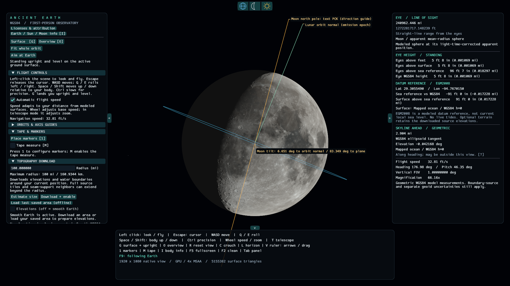

# Using Ancient Earth

## Navigation

The app opens standing at **29.305549, -94.767015**, facing east. City catalogs, city search, map pins and named location shortcuts remain removed. GPS entry and free flight remain available. Select **Surface** to stand on the active surface at your current latitude and longitude. Press **O**, or launch with `--overview`, for the globe overview.

Land and water share the **WGS84 ellipsoid at height zero**. This is the default with elevations off; optional downloaded terrain is described below. No bathymetry is provided. Earth's curvature remains. **Land & Water → Show mapped land / water** controls surface categories; it does not change surface height. Detailed water masks take precedence over the bundled, coarse Natural Earth land/ocean context. Earth imagery remains removed. The base app works offline; optional live weather downloads are described below.

Select **Coast view**, or launch with `--coast`, to inspect a boundary derived from the loaded masks:

```powershell
$env:WGPU_BACKEND = "dx12"
.\target\debug\ancient-earth.exe --coast --datetime "2026-10-21 18:00:00" --paused
```

The map provides surface categories only. Its finite resolution limits boundary detail; global context is a cartographic overview, not a surveyed shoreline. No live tides are provided. See [the current surface model](science/water.md).

Open **Licenses & attribution** at the top of the navigation panel to read data and software/font notices. `ancient-earth.exe --licenses` prints them without opening a graphics window. Keep the license files included in packaged distributions when sharing the app.

The compact arrows on the left, right and bottom panel edges collapse each panel separately; the arrow remains at the screen edge to reopen it. Panel text uses a smaller default size. **Observer & Display → Show tooltips** disables or restores hover help.

Every section in the left navigation panel starts collapsed at launch. Click a section heading to expand it. Custom-weather layers also start collapsed. Your expanded sections stay open when you hide and restore the panel during the same session; restarting returns them to the collapsed defaults.

The first three small top icons select **Earth, Moon and Sun**, in that order. Click once to aim at the body's center. Double-click to track it while you fly or change time; the selected icon is highlighted. Double-click that icon again to stop. A single click on the currently tracked icon keeps tracking active. Manual mouse look, unlocked Q/E roll or an explicit navigation action stops tracking. Aiming does not move you, change zoom or reveal a body hidden behind Earth. Weather refraction can shift the visible image from the aiming direction.

The fourth icon is **Horizon lock**; the same toggle appears under **Observer & Display**. It starts enabled and keeps your view upright near Earth, allowing you to look up/down freely. Q/E does nothing while the lock is active. The icon is teal when active, amber when armed for return from space, and muted when off. Turn it off for free body roll everywhere. It is independent of the L/V measurement lines, weather refraction and F2 clean view. `--no-horizon-lock` disables it at launch. Earth's actual curvature and horizon dip remain visible; see [the leveling definition and control threshold](science/horizon-lock.md).

**Left-click the scene** to capture the mouse. Move the mouse to look around without holding a button. **Escape** gives the cursor back and stops keyboard flight; losing window focus or opening a dialog also releases capture. With the mouse captured, W/S follows your gaze, A/D moves sideways, and **Q/E rolls your body left/right when horizon lock is inactive**. **Space/Shift moves up/down relative to your body's current orientation**, including when tilted or inverted. Either Shift key moves body-down; Shift no longer boosts speed. Hold Ctrl for precision movement. Opposing keys cancel each other. Clicking a panel does not capture the mouse.

**G**, or the **Surface** button, lands you on the active ground surface and restores an upright, level view while preserving your heading. This also works after rolling upside down. Release held flight keys to remain in that landing pose.

**Flight Controls → Automatic flight speed** starts enabled and adapts navigation speed to nearby modeled surfaces. The wheel adjusts base speed; in telescope mode it adjusts zoom instead. Turn automatic speed off for a fixed base speed. The HUD reports the available navigation speed, including held modifiers.

Hold **C** to crouch; release it to stand. **Observer & Display** also provides a persistent **Crouch** checkbox and separate standing/crouching eye-height settings. Keyboard flight and crouching are suspended while typing in GUI fields.

**Observer & Display → Frame limit** selects 30, 60, 120 FPS or Unlimited. The default is 60 FPS. Background windows are limited to 15 FPS and minimized windows to 5 FPS; actual performance can be lower. Time playback continues using elapsed time. The equivalent launch option is `--frame-limit 30`, `60`, `120` or `unlimited`. VSync remains enabled.

**F2 clean view** keeps a small **Height:** readout in the upper-right corner. It uses the same eye height above the active surface as the normal HUD, updating during flight and crouching. Heights remain in feet or metres, with miles or kilometres in parentheses, according to the selected units. L/V guides and the tape remain independently available.

The observer's feet are constrained by the active physical surface: smooth WGS84 or enabled downloaded terrain. There is no gravity or momentum. Flight is a navigation tool, not a physically valid aircraft or spacecraft simulation.

## Globe and Earth orbit

Keep using the same flight controls to travel from the ground into space. The orbital path and Earth-axis guides become available automatically at suitable space-view distances. There is one physical camera; **B is no longer a mode switch**. **Aim at Earth**, **Aim at Sun** and **Aim at Moon** turn your view toward the selected body without moving your eyes.

The globe displays the licensed global continent and ocean boundaries using the same surface renderer as ground flight. Enabled downloaded terrain stays active. Earth photographic imagery remains removed. **Overview [O]** and **Fit whole orbit** are optional position presets; neither is needed to fly outward. **Surface [G]** returns your feet to the active surface at your current coordinates.

Open **Orbits & Axis Guides** to toggle the Earth orbital path and the Earth or Moon axis / tilt / orbital-plane guides. The Moon guide also works in telescope view. These are annotations over the physical scene and are hidden during active weather refraction. Definitions, projection behavior and finite model limits are in [orbital mathematics](science/orbital-overview.md) and [lunar rendering](science/lunar-rendering.md).

The Moon uses NASA LRO-based color and LOLA-derived crater shading. The maps have finite resolution, and relief changes lighting only: the silhouette and distance intersections remain spherical. The source color is processed for appearance rather than calibrated reflectance. Open the lunar documentation above for registration, illumination and tilt definitions; source credits and redistribution terms accompany the app.



This native capture uses the default ground coordinates and the paused simulation date `2026-10-21T02:00:00`. Lunar source: NASA's Scientific Visualization Studio / LROC / LOLA; full credits and derivative notices are in [NOTICE.md](../NOTICE.md).

Date, Play/Pause, time steps and F9 affect your current observer throughout flight. **R** restores the normal lens without moving you. **F2** hides the main panels while retaining enabled annotations and the eye-height readout. **I** opens body information for your current eye position. Startup options `--globe-view` and `--orbit-view` set an initial position in this same view; `--look-earth` turns the initial view toward Earth without moving it.

Topography downloads can finish and activate during flight, subject to the usual ground-clearance check.

## Tape measure and marker rows

Press **1** (or numpad **1**) to open **Place a row of markers**. Nothing spawns until you select **Spawn markers**. Set **Spacing**, **Extend to**, and **Offset left**; the defaults are half a mile, 40 miles, and 100 feet. The menu records your position and horizontal heading when opened. The first marker is beside you at the left offset; subsequent markers continue ahead at the selected spacing. Each new row replaces the previous row; **Tape & Markers** lets you hide or clear it.

Each grounded rectangular marker is **10 feet wide, 10 feet deep, and 100 feet tall**, with alternating one-foot red/green bands starting red at its base. Markers follow the curved Earth; they are not guaranteed to remain visible beyond the horizon. Use **T** and the wheel to inspect distant markers. Bands smaller than a screen pixel are filtered to reduce shimmering.

A flat black sign above each marker shows its number in white: **0001**, **0002**, and onward from the first marker beside you. Signs turn toward your eyes while keeping their vertical axis aligned with the marker. They remain visible in F2 and telescope views when the scene does not obstruct them. The signs are annotations; hidden-height and tape measurements still use the original marker bodies.

Aim the center dot at a visible marker to show its eye range, station distance and hidden height. The hiding measurement follows the marker's vertical centerline. With terrain enabled it is explicitly a sampled estimate, which can miss narrow obstructions. Fully hidden markers cannot be selected through the Earth. The boxes are measurement objects and do not block flight.

Click the scene once to capture mouse look; that click does not place a tape point. Press **M**, or enable **Tape measure**, then aim the dot and **left-click for A**, aim elsewhere and **left-click for B**. A third click starts another tape. The panel also has **Set A from dot**, **Set B from dot**, and **Clear tape**. Endpoints attach to the picked ground or marker position; decorative grass and celestial bodies are excluded. A is cyan and B is yellow. A thin on-screen tape connects the points, with small distance labels beside it. The annotation remains visible over the ground and works in **F2** clean view. It shows straight-line separation and a separately labeled WGS84 surface geodesic; the latter ignores elevations and is not a terrain-following walking route.

**M** hides/restores the tape without deleting its endpoints. **Show markers** hides/restores the row. When refraction is eligible, terrain and marker picks use the same curved viewing paths. The tape still measures the physical straight chord between endpoints; refracted marker hidden-height results are explicitly sampled image-branch estimates. Survey captions remain available in **F2** clean view. Changing the physical ground surface clears existing markers and tape points so they cannot silently refer to the old surface.

See [survey geometry and its reviewed limits](science/survey.md). Native QA presets are `--marker-menu` (menu only), `--survey-row` (the background placement workflow at the current pose), `--survey-demo nearby` (the first marker viewed from the startup position), `--survey-demo close` (bands/tape) and `--survey-demo horizon` (partial hiding). These do not change the ordinary startup location.

## Downloading elevations

Open **Topography Download**. Set **Radius** around your current in-app location; the default and maximum is **100 miles (160.9344 km)**. Larger requests are rejected before downloading. **Estimate size** checks provider sizes and verifies cache files without downloading rasters. **Download + enable** downloads missing elevation files and their matching water masks, prepares terrain in the background and enables it. The panel shows progress, approximate storage and a separate water-mask count. Full tiles and seam-support neighbors extend beyond the radius, so even a small radius may need several files.

If an older download shows only a small rectangular coastal map, click **Download + enable** once with the desired radius. Verified elevation files are reused; the missing water masks are added. **Load last saved area (offline)** cannot fetch these new files. Subsequent offline loads restore both layers. Turning elevations off keeps the downloaded land/water classification on the smooth Earth.

**Elevations (off = smooth Earth)** restores the smooth surface without deleting files. Re-enable it to restore the prepared terrain immediately. After restarting, **Load last saved area (offline)** reloads the last completed area without network access. The usual cache is `%LOCALAPPDATA%/AncientEarth/topography`; set `ANCIENT_EARTH_TOPOGRAPHY_CACHE` before launch to choose another folder. The active area's size includes its source/support tiles; other previously downloaded areas remain cached too.

Downloads and preparation are cancellable. Completed files survive cancellation or failure, and the previous active scene stays until replacement is ready. Activation preserves position unless the new surface would enclose your feet; the app then raises you and reports the adjustment. Disabling terrain may likewise raise you from negative terrain onto WGS84.

The panel explicitly reports whether downloaded terrain covers the ground beneath you. **Stand on downloaded ground** moves your feet onto that surface; activation alone can leave you hovering when the imported ground is lower. The import summary distinguishes nearby detail from the coarser regional mesh. Use **Load last saved area (offline)** to rebuild an existing download with the current importer; another download is unnecessary. Coastal water and low land can remain nearly level, and heights are never exaggerated to make relief more visible.

Copernicus GLO-30 is a surface model including vegetation and buildings. Source resolution, gaps and retained mesh spacing limit detail. Missing elevation coverage remains smooth reference surface. Matching Copernicus water masks supply categories; outside detailed coverage, bundled Natural Earth supplies coarse land/ocean context. Missing source files are never interpreted as ocean. No imagery or bathymetry is downloaded. See [scientific interpretation](science/topography.md).

Eligible weather refraction now intersects downloaded terrain and marker geometry; view, range and guides use the same current optical scene. Missing or ineligible weather and eyes outside the supported optical height range use an explicitly labeled geometric fallback. With an eligible optical profile, pending or unsupported scene preparation instead reports that state; it does not silently substitute a straight view. The cache includes source provenance, checksums, a `licenses/assets.json` inventory, provider terms and notices. Keep these when sharing data; unknown/revised source terms are refused.

Imperial is the default. The right-pane **Eye Height** and **Datum Reference** sections show feet and whole inches, rounded to the nearest inch, with miles in parentheses. A leading minus sign applies to the entire feet-and-inches amount. Other height readouts retain decimal feet with miles in parentheses. Metric uses metres with kilometres in parentheses. Display rounding does not change the underlying measurements. Launch with `--metric` to override the default.

## Coordinates

Enter decimal-degree geodetic latitude and longitude: north and east are positive, south and west negative. Accepted angular ranges are latitude [-90, 90] and longitude [-180, 180]. Coordinate fields retain double precision.

**Feet height** is altitude above WGS84 in the selected unit. In smooth mode it also equals feet clearance; over downloaded terrain, clearance is measured relative to the actual mesh. The geoid reference remains separate. **Go to exact coordinates** preserves the entered height and rejects a destination below the active surface. **Go to ground at coordinates** places the feet on the active surface at that latitude and longitude. Eye altitude adds the configurable eye height. Invalid coordinates report an error without moving the observer.

**Use current** copies the observer's current coordinates into the fields. Changing units changes displayed lengths, speed and height inputs while preserving the physical location.

## Eyes and distance

The observer is six feet tall. Standing eyes default to 1.72 m above the feet; crouching eyes default to 1.00 m. Both are adjustable conventions because total stature does not uniquely determine eye position. Crouching keeps the feet fixed and changes the actual camera origin, perspective and measurements.

The small center dot defines a single forward ray. The HUD identifies the nearest measured target: the selected Earth surface, a visible survey prism, a visible grass blade or a modeled Sun/Moon sphere. Where mask coverage exists, the surface hit is labeled as land or mapped water. An unobstructed ray with no target reports **No surface intersection**. Measurements describe the mathematical model, not surveyed real-world terrain.

The vertical readout uses the point at your current latitude and longitude, even while flying. **Eyes above surface** includes flying clearance; the configured eye offset is only the height above your feet. **Eye WGS84 height** is ellipsoidal altitude. The separate **Datum reference / EGM2008** readout compares the observer and surface with the geoid. The HUD comparison itself does not move the surface. Imported Copernicus heights separately use the explicit EGM2008-to-WGS84 conversion; neither is a live tide measurement.

The **skyline** readout follows the current eye position and heading. Turning, moving or crouching updates it. Its atmospheric mode and numerical limits are described in [scientific visibility](science/visibility.md) and [refraction](science/refraction.md).

## Weather and refraction

Open **Weather & Refraction** in the navigation panel and check **Enable weather refraction**. Unchecking it restores the geometric view and stops new weather requests. The feature starts disabled. Add `--weather` at launch to enable live weather immediately.

On Windows, launch with `$env:WGPU_BACKEND = "vulkan"` for the curved-ray display. DirectX 12 currently disables that display after repeated native device-loss failures; the panel explains the reason, weather data stay available, and the view and measurements consistently remain geometric. See [backend selection](#windows-startup-diagnostics).

The panel shows the NOAA forecast model, source grid coordinates, run time, valid time and current download/cache/error status. Supported CONUS locations use finer HRRR 3km surface/2m conditions with a GFS vertical column; elsewhere, or when regional validation fails, the explicit fallback is GFS. The GFS column now includes its actual 80m temperature, pressure and specific humidity. The cross-model join is a documented approximation, with conservative limits on differing model grounds and join height. The column's fixed surface anchor is shown separately from the source grid: it is set at the requested observer location when a new source or scene is bound and does not follow hills as you move. This does not measure thin local mirage layers. **Refresh weather** requests an update. Moving to another source grid location invalidates the old profile before rendering. Downloads run in the background, with a short location debounce and a retry cooldown. A failed refresh can retain only an eligible previous profile; otherwise the geometric view remains active. A public forecast is not a weather-station measurement at your exact position.

Use **Custom weather**, immediately below **Refresh weather**, to expand an editor seeded from the loaded weather for your location. Expand a layer to edit its temperature, pressure and specific humidity. **Apply custom weather** validates and activates the edited column; typing alone does not change the view. **Reset edits** reloads the currently active column. If weather or terrain changes while you are editing, reset before applying. **Use live weather** discards the custom scenario and requests weather for your current location. Custom settings remain fixed while you fly, survive toggling refraction off/on, and last only for this session. See the [custom column model and units](science/refraction.md#custom-columns).

Live weather follows **real computer UTC**, independently of the Sun/Moon calendar. Changing the calendar does not retrieve historical or future weather. The base scene still works without a connection. On Windows, the latest validated response is cached in `%LOCALAPPDATA%\AncientEarth\weather`; `ANCIENT_EARTH_WEATHER_CACHE` can select another directory. Cache bytes must match their recorded request and SHA-256, and pass scientific validation again before reuse.

For offline verification, `--weather-reference` selects the bundled fixed GFS snapshot, while `--weather-regional-reference` selects the independently checked HRRR/GFS pair. Both are explicitly labeled frozen scenarios. It is never substituted silently after a live download fails. **Use live weather** exits this verification mode. Do not combine live weather with a fixed-reference launch switch.

With the optical display active, the view and L/V guides use the optical model documented in [refraction](science/refraction.md). The distance HUD distinguishes curved geometric path, straight endpoint distance and phase optical path. Grass and its shadows are hidden in this mode because decorative blades do not yet support curved-ray visibility. Surface/sky lighting is simplified; disabling refraction restores the existing PBR lighting, grass and shadows. Thin local mirage layers, scattering and cloud obscuration are unresolved, so the app cannot guarantee the appearance or visibility of an actual mirage.

The optical display supports WGS84 ellipsoidal eye heights from **−10 km through +20 km**, subject to being above the active ground. Negative values support coastal terrain below the reference ellipsoid. Above this range, the view, range readouts and L/V guides consistently use the geometric mode while weather data remain visible. A status identifies this fallback, including in F2 clean view. Within the supported range, an individual ray that exceeds the numerical budget or cannot resolve a thin layer is marked purple instead of inventing a hit. This is a display limit, not an atmospheric boundary.

Refraction remains demanding. Disabling the toggle restores the existing geometric renderer. Exact-input reuse avoids repeating the primary calculation while the view and physical inputs remain unchanged. Moving or changing the view requires new rays, and smooth flight with refraction enabled has not yet been established. The [current performance evidence](../README.md) distinguishes stationary reuse, moving-view diagnostics and verified foreground tests. Other views and machines can differ; a saved image is not a frame-rate guarantee. The [validation record](development/validation.md) preserves test configurations and earlier results.

For a repeatable magnified horizon comparison, use `--weather-horizon-check --clean-view --line --paused --datetime "2026-10-21 18:00:00"`. Capture once without a weather option and once with `--weather-reference`. This diagnostic uses the independently reviewed source-column pose and lens, not a city catalog or a claim about current conditions.

## Optics

**Normal / no fisheye** is a rectilinear pinhole projection. It has no radial fisheye distortion; very wide rectilinear views still stretch near the edges. Lowering field of view reduces that effect.

**Equidistant fisheye** uses a circular aperture and angular radial projection. Pixels outside the aperture have no view ray.

**Telescope** uses rectilinear optics from the same eye position. The wheel changes field of view instead of movement speed. Normal and telescope settings are stored separately. Turning off the telescope restores the previous normal/fisheye lens.

Press **R**, or choose **Optics & Units → Reset view [R]**, to exit telescope mode and restore the default normal rectilinear view. This works in F2 clean view, keeps your position and viewing direction, and preserves your telescope's zoom for the next time you use it. The shortcut is suspended while typing in a GUI field.

The GPU camera uses a 0.02 m near clip and a finite 4×10¹² m culling distance, covering the supported Earth–Moon–Sun scene. Telescope zoom cannot create boundary detail absent from the source data. Field of view, f32 display precision and mesh tessellation all have finite limits. Extreme zoom can expose polygon edges or display precision even while f64 measurements remain stable. See [rendering mathematics](science/rendering.md).

## Display

The window starts at **1920 × 1080**. Press **F5** to use borderless fullscreen at the current monitor's resolution; press it again to restore the previous window size and position. The GPU draws at native resolution with antialiasing. **Visual detail**, in **Observer & Display**, controls surface rendering and grass coverage. Measurements use the canonical active surface, independently of display LOD.

Startup shows **Preparing graphics** while Earth geometry and GPU shaders become ready. The window continues updating during background pipeline compilation, and **Close app** remains available. Flight starts after preparation finishes. Selecting a new optical mode can show **Preparing this view** while its geometry and shaders prepare. Cold shader compilation can take minutes; readiness is not tied to a promised short delay. Driver initialization and resource uploads can still cause pauses. Automated screenshots and stationary capture warmup wait for graphics readiness as well as scene preparation.

Windows can constrain a decorated window to its available work area. Automated `--screenshot` runs can add `--capture-fullscreen` to capture the current monitor's full resolution. Screenshot and frame-capture checks suppress gameplay mouse/keyboard input. Leave GUI controls untouched during these checks; ordinary launches remain fully interactive.

For repeatable optical checks, add `--view-fov DEGREES`; for example, `--fisheye --view-fov 60` selects a narrow equidistant view, while `--telescope --view-fov 5` selects the telescope lens. The argument is the vertical field of view, not a magnification factor. Missing/nonfinite values are rejected. Finite values use the existing lens clamp: 0.000001° minimum, with a 150° rectilinear or 180° fisheye maximum. The dedicated `--weather-horizon-check` fixture retains its own diagnostic lens.

The arrows at the left, right and bottom screen edges collapse or restore navigation, measurements and flight help independently. Collapsed panels leave their restore arrows visible. Tab also toggles navigation. The right panel stops its background skyline measurement while collapsed; enabled L/V guides continue their own measurements.

**F2** hides panels, edge arrows and the center dot; press F2 again to restore the previous panel states. **L and V remain independently available in clean view**, including their labels and Left/Right or drag adjustment. F2 preserves the guides' current enabled state. Flight and time playback continue. Start this way with `--clean-view`. `--panels-collapsed` starts with only the restore arrows.

Press **I**, or choose **Earth / Sun / Moon info [I]** in navigation, for the astronomical information window. It works with panels collapsed and in F2. Choose the Earth, Sun or Moon tab for model dimensions, distances and relevant simulation measurements, shown in metric and Imperial units together. Values follow the simulation date, position and Earth-follow mode. Static dimensions remain available when the live sample is unavailable; the status explains this. Scroll for model notes and source links. Press I again or use the window's close button. `--body-info` opens it at startup. See [definitions, mathematics and sources](science/astronomy-info.md).

**Show grass**, in **Observer & Display**, lets you inspect the underlying smooth surface. The launch option `--no-grass` starts with grass hidden. `--quality performance`, `--quality balanced`, `--quality fine` and `--quality high` select the corresponding detail preset. The app currently keeps settings in memory for the current session only.

Press **L** to toggle the one-physical-pixel horizontal guide at the highest detected visible skyline. Its labels report both the straight-line span and WGS84 reference-surface distance between the selected visible skyline endpoints, in the selected units. The guide is unavailable when no usable skyline is found. The same toggle is in **Observer & Display**.

Turning **L** on enables V by default. Press **V** to hide or restore the vertical guide. Hold **Left / Right arrow** or drag its marker to move it. Its label updates as it moves and when you change units. The label identifies the modeled gap at the selected skyline point's depth; it is not a surveyed terrain height or a direct measurement of Earth curvature. See the [guide definitions and limits](science/horizon-guides.md).

Weather-refracted guides run in the background. Moving or resizing the view cancels obsolete work; an updating message replaces an outdated measurement until the current view is ready. Pause camera movement to let a demanding optical measurement finish. L and V use non-antialiased, one-physical-pixel rectangles, including on scaled displays. Disabling L cancels its work, and F2 skips the hidden heading readout while retaining enabled guides.

For a repeatable view of the horizon and both rulers, launch:

```powershell
.\target\debug\ancient-earth.exe --guide-demo horizon --vertical-guide --guide-column 0.8 --datetime "2026-10-20 12:00:00" --paused
```

Use `--guide-demo rolled --no-horizon-lock` for a tilted view, or `--guide-demo sky` to check the unavailable-horizon message. `--imperial` selects imperial units at launch. These presets hide the navigation panel; press Tab to reopen it. In a packaged copy, run `ancient-earth.exe` directly from its extracted folder.

## Sun, Moon and time

The simulation starts at the current computer time. **Sun, Moon & Time** shows the simulation date and provides **Play / Pause**, **Now**, speed presets and an editable playback rate. `1x` advances in real time; a negative rate reverses playback.

Press **F9** to stop following Earth's rotation. Your view stays in the Earth-centered nonrotating frame as the planet turns beneath you. Press F9 again to follow Earth at your current location. Use **Play**, faster playback or time steps to see the effect; paused time holds both views still. Flight, looking and teleports remain available. **Observer & Display → Follow Earth rotation** controls the same setting, and `--earth-unlocked` starts with it unchecked. See [reference frames](science/reference-frames.md) for the model and collision limits.

Horizon lock can still level the camera near Earth while F9 is unlocked. Turn horizon lock off to retain the fully nonrotating camera orientation, including bank. The lock preserves the current aim and eye position.

**Aim at Sun** and **Aim at Moon** turn the view toward that body's current apparent center without moving you. The ground may obscure it. Use the telescope to magnify it. The corresponding launch switches are `--look-sun` and `--look-moon`.

Enter `YYYY-MM-DD HH:MM:SS` and select **Apply date / pause** to inspect a date. **Seconds per step** defines an interval; **Step count** may be positive or negative. **Step / pause** applies that many intervals and pauses playback. Years outside 1850–2149 are rejected rather than extrapolating the planetary ephemeris.

For repeatable launches, use `--datetime "2026-10-20 18:00:00" --paused`. The calendar uses UTC from 1960 onward and the identified historical model before then. The panel reports whether Earth rotation uses measured, predicted or modeled data. Future leap seconds and Earth rotation are not exactly knowable. See [scientific astronomy](science/astronomy.md) for the data, equations and independently checked limits.

Eclipse geometry and shadows remain active for your coordinates and selected date. The former named location demonstrations have been removed. See [the eclipse model and verification limits](science/eclipses.md).

## Recording frame pacing

For a repeatable stationary check, run a separate capture without `--screenshot`:

```powershell
$env:WGPU_BACKEND = "dx12"
& ".\target\debug\ancient-earth.exe" --coast --datetime "2026-10-20 18:00:00" --paused --frame-capture artifacts/performance/coast.json
python scripts/analyze_frame_capture.py artifacts/performance/coast.json
```

The app warms up, records raw application frame intervals and exits. Keep the window focused and leave the camera and display settings unchanged. The report includes the adapter, display settings and any detected view changes. It measures application frame pacing on that configuration, not GPU execution time.

For the automated movement and grass-regeneration check, add `--frame-capture-motion` to that launch command and choose a different output file. This mode moves the observer and changes display settings automatically, then exits. Its report identifies the run as a movement check, separate from a stationary performance baseline. See [the verification procedure](science/verification.md#reproducible-frame-pacing) for the checks and their limits.

Use `--frame-capture-view-motion` instead for the repeatable zoom-and-ascent check. It records all frame intervals while changing the lens and climbing, including time spent preparing display detail. The two motion modes are mutually exclusive. `--topography-inspect` loads the last saved area offline and selects an explicit inspection view of retained terrain near its center; it reports an error if that coverage is unavailable.

## Windows startup diagnostics

Packaged Windows builds need the x64 Microsoft Visual C++ v14 runtime. If Windows reports missing `VCRUNTIME140.dll` or `VCRUNTIME140_1.dll`, install the x64 package from [Microsoft's supported redistributable downloads](https://learn.microsoft.com/en-us/cpp/windows/latest-supported-vc-redist). The runtime must be at least as recent as the MSVC build tools used for the app. It is a system prerequisite and is not bundled in Ancient Earth's ZIP.

Messages such as `loader_get_json: Failed to open JSON file C:\VulkanSDK\...\VkLayer_*.json` mean the Vulkan loader could not open a layer manifest. They do not by themselves mean the app failed: check subsequent messages for graphics adapter selection and window creation, and check whether the globe appears.

For weather refraction, select Vulkan in PowerShell from the repository directory:

```powershell
$env:WGPU_BACKEND = "vulkan"
& ".\target\debug\ancient-earth.exe" --weather
```

To bypass Vulkan for geometric viewing, use DirectX 12:

```powershell
$env:WGPU_BACKEND = "dx12"
& ".\target\debug\ancient-earth.exe"
```

For a release build, use `.\target\release\ancient-earth.exe` instead. Bevy reads `WGPU_BACKEND` when initializing graphics; the variable changes the backend for apps launched from this PowerShell session. Close that shell to discard the setting, or run `Remove-Item Env:WGPU_BACKEND` before the next launch to restore automatic selection. This workaround needs no rebuild or system configuration changes.

DirectX 12 rendered the geometric globe and GUI in earlier tests. The newer terrain/marker optical shader failed native 1080p tests with device loss on the AMD Radeon RX 7900 XTX, so the app explicitly disables refraction on this backend. Switching backends requires restarting the app. The same optical scene passed native 1080p presentation with Vulkan; see [validation](development/validation.md).

Gamepad messages about an unknown mapping or an unavailable controller are separate from graphics initialization. This app uses keyboard and mouse controls. A PowerShell upgrade notification is also separate from the app.

References: [Bevy graphics backend selection](https://docs.rs/bevy/latest/bevy/render/settings/struct.Backends.html) and [Khronos Vulkan layer manifests](https://github.com/KhronosGroup/Vulkan-Loader/blob/main/docs/LoaderLayerInterface.md).
